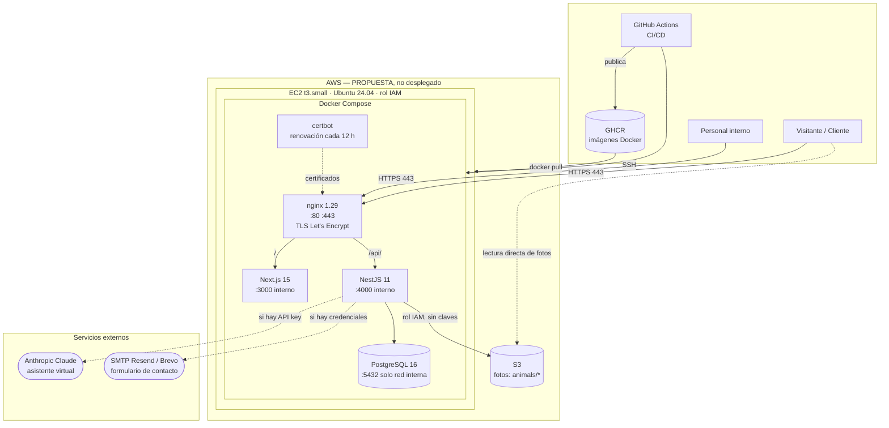

# Respuestas para el documento de tesis

Respuestas a `hola.md`, extraídas del código real del proyecto el **2026-11-14**.

**Convenciones**, las mismas que pediste:

| Marca | Significado |
|---|---|
| ✅ | Verificado en el código o la configuración |
| **NO EXISTE** | El artefacto no está en el proyecto |
| **PENDIENTE** | Dato del equipo, no deducible del código |
| **PROPUESTA** | Sugerencia con justificación, no un hecho |

---

# PARTE 0 — Correcciones urgentes a `hola.md`

Hay seis supuestos en tu documento que **no coinciden con el proyecto real**. Si los dejas, el
capítulo técnico quedará describiendo un sistema que no existe.

| # | `hola.md` asume | Realidad del proyecto |
|---|---|---|
| 1 | «Cap VI: incluye **Python/scikit-learn**» | ❌ **No hay Python en el proyecto.** El Random Forest está implementado desde cero en TypeScript, sin librería de ML. Motivo: las tres librerías de ML para Node (`ml-random-forest`, `ml-xgboost`, `ml-logistic-regression`) no se actualizan desde **mayo de 2022** |
| 2 | «¿Es un **microservicio**? ¿Cómo se comunica con NestJS (endpoint, puerto)?» | ❌ **No es un microservicio.** El modelo corre **en proceso** dentro de NestJS. No hay segundo puerto ni comunicación entre servicios |
| 3 | «EC2: qué corre ahí (Nginx, **PM2**, Docker)» | ❌ **No se usa PM2.** Todo corre en contenedores Docker orquestados con `docker compose` |
| 4 | «Dónde se guarda el modelo (**¿S3?**)» | ❌ **No va a S3.** Se serializa a JSON y se guarda en la tabla `ml_models` de PostgreSQL. S3 solo guarda **fotos de animales** |
| 5 | Asume que sigue existiendo **auditoría** (RN-09) | ❌ **Eliminada por completo** el 2026-11-14: tabla, trigger, interceptor y 41 llamadas. **El sistema ya no cumple RN-09** |
| 6 | Asume que siguen existiendo los **reportes** | ❌ **Eliminados.** Los reemplazan 6 indicadores de gestión en `/kpis` |

---

# PARTE 1 — Respuestas a «Lo que necesito de ti» (sección 4)

## 1.1 Datos de carátula

**PENDIENTE — nada de esto está en el código.** Lo debe completar el equipo:

| Dato | Estado |
|---|---|
| Registro universitario de Claudia | PENDIENTE |
| Registro universitario de Julio | PENDIENTE |
| Número de grupo | PENDIENTE |
| Sigla de la materia | PENDIENTE |
| Semestre | PENDIENTE |
| Fecha de entrega | PENDIENTE |

Único dato verificable: los commits del repositorio están firmados como
`Julio Avila <peptio2345@proton.me>`, pero esa es la configuración local de git, **no** evidencia
de la composición real del equipo.

## 1.2 Empresa ficticia del equipo

**PENDIENTE en su totalidad.** El código no menciona ninguna empresa. Lo que sí existe son los
datos de la **institución cliente** (la Asociación de Zoonosis), que son distintos y además son
valores de ejemplo pendientes de reemplazo:

```
INSTITUTION_NAME="Asociación de Zoonosis de Santa Cruz de la Sierra"
INSTITUTION_SHORT_NAME="Zoonosis SCZ"
INSTITUTION_ADDRESS="Santa Cruz de la Sierra, Bolivia"
INSTITUTION_PHONE="+591 3 000 0000"        ← número de ejemplo
INSTITUTION_EMAIL=contacto@zoonosis.test   ← dominio .test, no es real
```

Faltan por decidir: nombre, tipo de sociedad, capital, socios con porcentajes y domicilio.

## 1.3 Declaración Jurada Formulario N°101

**Fuera del alcance del código.** No puedo identificar el formulario sin verlo; está escaneado y
no forma parte del proyecto de software. Lo debe resolver el equipo consultando el PDF original o
la institución que lo emite.

## 1.4 Estudio de mercado

**PENDIENTE.** No hay encuesta, resultados ni datos de mercado en el repositorio. El sistema no
recoge ninguna métrica poblacional ni de competencia.

Sobre **a quién se le vende**: el código no define un modelo comercial. Lo único que insinúa el
destinatario es la estructura de roles, que es de **una sola institución**: ADMIN, VETERINARIO,
GESTION, DIRECTIVO y CLIENTE. **No hay multi-tenancy**, es decir, no existe separación de datos
por organización. Si el modelo de negocio fuera SaaS para varios municipios o refugios, el
sistema **todavía no lo soporta** y habría que agregarlo. Es importante no afirmar lo contrario en
el capítulo de mercado.

## 1.5 Marketing y redes sociales

**PENDIENTE.** Existen las variables pero con valores genéricos, no cuentas reales:

```
SOCIAL_FACEBOOK=https://www.facebook.com/      ← portada genérica
SOCIAL_INSTAGRAM=https://www.instagram.com/    ← portada genérica
SOCIAL_TIKTOK=https://www.tiktok.com/          ← portada genérica
SOCIAL_YOUTUBE=                                 ← vacío
SOCIAL_WHATSAPP=https://wa.me/59170000000      ← número de ejemplo
```

**NO EXISTE**: capturas de publicaciones, códigos QR ni cuentas verificadas.

## 1.6 Modelo de negocio

**PENDIENTE.** El sistema **no tiene ninguna funcionalidad de cobro**: ni suscripciones, ni
pagos, ni facturación, ni pasarela. Esto tiene una consecuencia legal directa que conviene
registrar: **la Ley 393 de servicios financieros no aplica**, tal como ya sospechabas en tu
tabla del Cap XI. Puedes descartarla con fundamento técnico.

## 1.7 Capturas solicitadas

| Captura | Estado |
|---|---|
| Pantallas del sistema desplegado | **NO EXISTE** — no hay despliegue; sí se puede capturar el entorno local (`localhost:3000`) |
| Consola de AWS (EC2 y S3) | **NO EXISTE** — no hay cuenta de AWS conectada |
| Pipeline de GitHub Actions en verde | **NO EXISTE** — los workflows están escritos pero **nunca se ejecutaron**: el repositorio no tiene remoto |
| Pruebas | ✅ Se puede capturar ahora: `npm test` y `npm run test:e2e` |
| PageSpeed / Lighthouse | **NO EXISTE** — requiere una URL pública |

## 1.8 Fechas reales de sprints, revisiones y retrospectivas

**PENDIENTE.** No hay registro. El único dato temporal verificable es la fecha de las migraciones
de base de datos:

| Migración | Fecha real |
|---|---|
| `20261114042356_init` | 2026-11-14 04:23 |
| `20261114192825_portal_publico` | 2026-11-14 19:28 |
| `20261114220254_modelos_ml` | 2026-11-14 22:02 |
| `20261114230000_quitar_auditoria` | 2026-11-14 23:00 |

> **Observación honesta**: las cuatro migraciones son del mismo día. El repositorio de git se
> inicializó recién el 2026-11-14 y tiene 4 commits. No hay evidencia documental de un desarrollo
> distribuido en tres sprints de dos semanas. Si el documento afirma fechas de sprint, serán una
> reconstrucción del equipo, no un dato auditable.

---

# PARTE 2 — Random Forest (sección 2 de tu pedido)

## 2.1 Lenguaje, librería y arquitectura

| Pregunta | Respuesta |
|---|---|
| Lenguaje | ✅ **TypeScript 5.7.3** |
| Librería | ✅ **Ninguna. Implementación propia desde cero** |
| ¿Microservicio? | ✅ **No.** Corre en proceso dentro de NestJS |
| Comunicación con NestJS | ✅ No aplica: es un módulo Nest (`RecommendationModule`), llamada directa a `MlService` |
| Puerto | ✅ El mismo del API: **4000** |

**Justificación de no usar librería** (sirve para defender la decisión): las opciones disponibles
en npm tienen su última publicación en **2022-05-09**, más de cuatro años sin mantenimiento.
Además, para datos tabulares los ensambles de árboles superan al aprendizaje profundo, lo que
respalda la elección del algoritmo: *Grinsztajn, Oyallon & Varoquaux (2022), «Why do tree-based
models still outperform deep learning on typical tabular data?», NeurIPS*.

## 2.2 Archivos del modelo

Todos en `backend/src/modules/recommendation/ml/`:

| Archivo | Responsabilidad |
|---|---|
| `rng.ts` | Generador pseudoaleatorio con semilla (mulberry32); garantiza reproducibilidad |
| `dataset.ts` | Vectorización del par adoptante-animal; 16 variables; partición estratificada |
| `cart.ts` | Árbol CART con índice de Gini y submuestreo de variables por nodo |
| `random-forest.ts` | Bagging, error out-of-bag, importancia de Gini, explicación local, serialización |
| `logistic-regression.ts` | Línea base comparativa (descenso de gradiente + L2) |
| `metrics.ts` | ROC-AUC, Brier, matriz de confusión, validación cruzada estratificada |
| `synthetic.ts` | Generador del conjunto sintético etiquetado |
| `ml.service.ts` | Entrenamiento, versionado, activación, caché del modelo |
| `ml.controller.ts` | Endpoints REST |
| `ml.spec.ts` | **46 pruebas unitarias** |

Fuera de esa carpeta: `backend/scripts/ml-benchmark.ts` (comparación de los tres modelos,
`npm run ml:benchmark`) y `backend/src/modules/recommendation/engine.ts` (motor de reglas, que
sigue vivo como respaldo).

## 2.3 Variables de entrada (16)

| # | Variable | Tipo | Origen |
|---|---|---|---|
| 1 | `vivienda` | Ordinal 0-2 | Adoptante (departamento / casa sin patio / casa con patio) |
| 2 | `tiene_patio` | Binaria | Adoptante |
| 3 | `tiene_ninos` | Binaria | Adoptante |
| 4 | `tiene_otros_animales` | Binaria | Adoptante |
| 5 | `horas_disponibles` | Continua | Adoptante |
| 6 | `experiencia` | Ordinal 0-2 | Adoptante (ninguna / básica / avanzada) |
| 7 | `animal_es_perro` | Binaria | Animal |
| 8 | `animal_es_gato` | Binaria | Animal |
| 9 | `tamano_animal` | Ordinal 0-2 | Animal |
| 10 | `nivel_energia` | Entera 1-5 | Animal |
| 11 | `necesita_patio` | Binaria | Animal |
| 12 | `cuidados_especiales` | Binaria | Animal |
| 13 | `horas_requeridas` | Continua | Animal |
| 14 | `razon_horas` | Continua, acotada a 3 | **Derivada**: horas disponibles / horas requeridas |
| 15 | `coincide_especie_preferida` | Binaria | Cruce |
| 16 | `coincide_tamano_preferido` | Binaria | Cruce |

**Decisión de diseño documentable**: `goodWithChildren` y `goodWithAnimals` **no son variables del
modelo** a propósito. Generan vetos absolutos de seguridad que resuelven los filtros duros *antes*
de llegar al modelo; dentro del conjunto que pasa esos filtros quedan determinadas y no aportan
información.

**Variable objetivo**: binaria.
`1` = adopción sostenida (solicitud `APROBADA`), `0` = no concretada (solicitud `RECHAZADA`).
Las solicitudes `CANCELADA` **se excluyen** del entrenamiento: una cancelación no dice nada sobre
la idoneidad del par (puede ser un cambio de planes) y etiquetarla como fracaso sesgaría el modelo.

## 2.4 Dataset

| Dato | Valor |
|---|---|
| Origen | ✅ **MIXTO**: 12 reales + 1500 sintéticos |
| Registros totales | ✅ **1512** |
| Casos reales disponibles | ✅ **12** solicitudes resueltas |
| Mínimo recomendado de reales | ✅ **150** (constante `MIN_REAL_SAMPLES`) |
| Balanceo | ✅ **47.22 %** clase positiva (sin remuestreo: ya está equilibrado) |
| Partición | ✅ **Validación cruzada estratificada de 5 pliegues**, no un train/test único |
| Semilla | ✅ **2026** (reproducible) |

**Advertencia metodológica que el documento DEBE incluir**: el conjunto es mayoritariamente
sintético. Se genera a partir de criterios de idoneidad de adopción responsable con un término
aleatorio que representa los factores no observados (entrevista, situación económica). El
generador **no reutiliza el motor de reglas** a propósito: si las etiquetas salieran del puntaje
ponderado, el modelo solo reaprendería las reglas y la comparación sería circular. Cada modelo
guarda su procedencia (`REAL`, `SINTETICO`, `MIXTO`) y la interfaz muestra la advertencia.
**Estas métricas validan que el canal de aprendizaje funciona; no son evidencia de capacidad
predictiva sobre adopciones reales.**

## 2.5 Hiperparámetros

| Parámetro | Valor | Nota |
|---|---|---|
| `nTrees` | 150 | Configurable, 10-500 |
| `maxDepth` | 10 | |
| `minSamplesSplit` | 4 | |
| `minSamplesLeaf` | 2 | |
| `mtry` | **4** | √16, el estándar para clasificación |
| `seed` | 2026 | Fija bagging y submuestreo |
| Criterio de división | Índice de **Gini** | `Gini(p) = 2p(1−p)` |
| Votación | *Soft voting* | Promedio de probabilidades, no voto mayoritario |

**Detalle técnico defendible**: se aceptan divisiones con **ganancia de Gini cero**, igual que
`min_impurity_decrease = 0` de scikit-learn. Exigir ganancia positiva impedía aprender
interacciones tipo XOR, porque en el nodo raíz ninguna variable sola reduce la impureza y el árbol
se detenía antes de llegar al segundo nivel. Está cubierto por una prueba específica.

## 2.6 Métricas reales — modelo v1 activo

Validación cruzada estratificada, 5 pliegues, 1512 casos:

| Métrica | Random Forest | Regresión logística (base) |
|---|---|---|
| Exactitud | **0.7606** | 0.7460 |
| ROC-AUC | **0.8298** | 0.8153 |
| F1 | **0.7490** | — |
| Brier (calibración) | **0.1671** | 0.1753 |
| Exactitud media ± σ | 0.7606 ± 0.0210 | — |
| Exactitud out-of-bag | **0.7500** | no aplica |

Estructura del modelo final: **150 árboles**, profundidad media **10**, **204.45 hojas** por árbol
en promedio.

### Matriz de confusión (benchmark de 1200 casos)

|  | Predijo éxito | Predijo fracaso |
|---|---|---|
| **Éxito real** | 417 | 150 |
| **Fracaso real** | 148 | 485 |

### Comparación completa de los tres modelos

`npm run ml:benchmark`, 1200 casos sintéticos, 5 pliegues:

| Modelo | Exactitud (umbral 0.5) | ROC-AUC | Exactitud (mejor umbral) | Brier |
|---|---|---|---|---|
| Motor de reglas (base) | 0.5125 | **0.8372** | **0.7717** | 0.3035 |
| Regresión logística | 0.7450 | 0.8179 | 0.7475 | 0.1739 |
| Random Forest | 0.7517 | 0.8260 | 0.7575 | **0.1695** |

> **Este resultado NO favorece al modelo en todo, y así debe reportarse.** El motor de reglas
> **ordena marginalmente mejor** (AUC 0.837 vs 0.826) y alcanza más exactitud en su umbral óptimo.
> El modelo gana en dos cosas concretas:
>
> 1. **Calibración**: Brier 0.17 contra 0.30. El puntaje de reglas no es una probabilidad, su
>    «0.5» no significa 50 % de éxito.
> 2. **Efecto techo**: en una prueba real sobre 5 animales, el motor de reglas asignó **100 a tres
>    de ellos** y no podía ordenarlos entre sí; el modelo los separó en 90.7 / 65.1 / 62.2.
>
> No se ajustó el generador para fabricar una victoria del modelo. Reportarlo así es más
> defendible que presentar una mejora inexistente.

### Importancia de variables (reducción media de impureza de Gini)

| # | Variable | Importancia |
|---|---|---|
| 1 | Razón horas disponibles / requeridas | 20.86 % |
| 2 | Horas de atención que requiere | 15.36 % |
| 3 | Horas disponibles por día | 11.98 % |
| 4 | Nivel de energía del animal | 6.85 % |
| 5 | Experiencia del adoptante | 6.43 % |
| 6 | Tamaño del animal | 5.55 % |
| 7 | Tipo de vivienda | 5.06 % |
| 8 | Tiene patio | 4.32 % |

## 2.7 Persistencia, versionado y reentrenamiento

| Pregunta | Respuesta |
|---|---|
| ¿Dónde se guarda? | ✅ **Tabla `ml_models` de PostgreSQL**, columna `model` tipo JSONB. **No en S3** |
| ¿Cómo se versiona? | ✅ Entero incremental; cada entrenamiento crea una fila nueva y conserva el historial completo con sus métricas |
| ¿Un solo modelo activo? | ✅ Garantizado por el índice único parcial `uq_one_active_ml_model` |
| ¿Se puede volver atrás? | ✅ `POST /ml/models/:version/activate` |
| ¿Cómo se reentrena? | ✅ `POST /ml/train` (solo ADMIN), o desde `/admin/modelo` en la interfaz |
| ¿Caché? | ✅ El modelo activo se deserializa una vez y queda en memoria |

Columnas de `ml_models`: `version` (PK), `algorithm`, `source` (enum REAL/SINTETICO/MIXTO),
`is_active`, `model` (JSONB), `metrics` (JSONB), `dataset_size`, `real_samples`,
`synthetic_samples`, `seed`, `notes`, `created_by`, `created_at`.

## 2.8 Filtros duros, niveles y RN-08

| Pregunta | Respuesta |
|---|---|
| ¿Se mantienen los filtros duros? | ✅ **Sí, y van SIEMPRE antes del modelo. El modelo no los puede anular** |
| ¿Cuáles son? | Animal no disponible; animal que no tolera niños en hogar con niños; animal que no tolera otros animales donde ya los hay |
| ¿Niveles ALTA/MEDIA/BAJA? | ✅ Sí. ALTA ≥ 80, MEDIA ≥ 60, BAJA por debajo |
| ¿Aviso RN-08? | ✅ Sí: *«Resultado de apoyo. La decisión final es del personal responsable.»* |

**Explicabilidad**: se conserva mediante **ablación de variables** (método de oclusión). Para cada
variable se vuelve a predecir reemplazándola por su mediana de entrenamiento, y la diferencia es
su aporte a ese caso: `aporte_j = p(x) − p(x con x_j := mediana_j)`. Es más simple que SHAP pero
del mismo espíritu, sin dependencias, con un costo de 16 predicciones extra por caso.

## 2.9 Endpoints del modelo

| Método | Ruta | Rol |
|---|---|---|
| GET | `/api/v1/ml/status` | ADMIN, GESTION, DIRECTIVO |
| GET | `/api/v1/ml/models` | ADMIN, GESTION, DIRECTIVO |
| GET | `/api/v1/ml/models/:version` | ADMIN, GESTION, DIRECTIVO |
| POST | `/api/v1/ml/train` | ADMIN |
| POST | `/api/v1/ml/models/:version/activate` | ADMIN |
| POST | `/api/v1/ml/deactivate` | ADMIN |

Endpoints de recomendación que **consumen** el modelo:

| Método | Ruta | Qué hace |
|---|---|---|
| GET | `/api/v1/recommendations/adopter/:id` | Ranking de animales para un adoptante |
| GET | `/api/v1/recommendations/animal/:id` | **Ranking inverso**: adoptantes para un animal (nuevo) |
| POST | `/api/v1/recommendations` | Puntaje de un par |
| GET | `/api/v1/recommendations/history` | Historial de un par |

## 2.10 Diagrama de secuencia

```mermaid
sequenceDiagram
  actor GES as Personal de Gestión
  participant FE as Next.js
  participant RC as RecommendationController
  participant RS as RecommendationService
  participant EN as engine.ts (reglas)
  participant ML as MlService
  participant RF as RandomForest
  participant DB as PostgreSQL

  GES->>FE: abre la ficha del animal, pestaña "Adoptantes compatibles"
  FE->>RC: GET /api/v1/recommendations/animal/:id
  RC->>RS: rankingForAnimal(animalId, user)
  RS->>DB: SELECT animal
  RS->>DB: SELECT adoptantes SIN solicitud activa
  DB-->>RS: lista de perfiles

  loop por cada adoptante
    RS->>EN: computeCompatibility(adoptante, animal, pesos)
    EN-->>RS: filtros duros + puntaje de reglas

    alt no pasa los filtros duros
      Note over RS: Veto de seguridad.<br/>El modelo NO interviene.
      RS->>RS: método = REGLAS, nivel = INCOMPATIBLE
    else pasa los filtros
      RS->>ML: activeForest()
      alt hay modelo activo
        ML->>DB: SELECT modelo activo (solo la 1ª vez; luego caché)
        DB-->>ML: JSON serializado
        ML-->>RS: RandomForest
        RS->>RF: predictProba(16 variables)
        RF-->>RS: probabilidad
        RS->>RF: agreement() y explain()
        RF-->>RS: acuerdo entre árboles + aportes por variable
        RS->>RS: método = MODELO, puntaje = prob × 100
      else no hay modelo
        Note over RS: Arranque en frío:<br/>manda el motor de reglas.
        RS->>RS: método = REGLAS
      end
    end
  end

  RS->>RS: sortRanking() — desempate estable
  RS->>DB: INSERT compatibility_recommendations (historial)
  RS-->>RC: ranking + aviso RN-08
  RC-->>FE: 200
  FE-->>GES: adoptantes ordenados con el porqué de cada uno
```

## 2.11 Pruebas del modelo

✅ **46 pruebas unitarias** en `ml.spec.ts`. Cobertura real de los módulos puros:

| Módulo | Sentencias | Ramas | Líneas |
|---|---|---|---|
| `synthetic.ts` | 97.80 % | 97.26 % | 98.64 % |
| `metrics.ts` | 97.27 % | 80.76 % | 98.71 % |
| `logistic-regression.ts` | 94.59 % | 25.00 % | 94.00 % |
| `cart.ts` | 94.20 % | 85.71 % | 94.64 % |
| `rng.ts` | 89.65 % | 33.33 % | 95.65 % |
| `random-forest.ts` | 80.00 % | 70.00 % | 82.17 % |
| `engine.ts` (reglas) | 90.98 % | 76.19 % | 97.97 % |
| `animal-status.ts` | **100 %** | **100 %** | **100 %** |

---

# PARTE 3 — Despliegue AWS y CI/CD (sección 3 de tu pedido)

> **Advertencia que debe aparecer en el documento: el sistema NO está desplegado.** Toda la
> infraestructura está escrita, validada y las imágenes Docker se construyen y arrancan
> correctamente, pero **nunca se ejecutó contra AWS** porque no hay credenciales. Describirlo como
> «desplegado» sería falso.

## 3.1 EC2

| Dato | Estado |
|---|---|
| Instancia creada | **NO EXISTE** |
| Tipo recomendado | **PROPUESTA**: `t3.small`. `t3.micro` funciona con los 2 GB de swap que crea `deploy/ec2-setup.sh` |
| Región | **PENDIENTE** — el valor por omisión de la configuración es `us-east-1` |
| Sistema operativo | **PROPUESTA**: Ubuntu Server 24.04 LTS (el script de preparación asume `apt` y repositorios de Ubuntu) |
| Disco | **PROPUESTA**: 20 GB gp3 |
| Qué corre ahí | ✅ **Docker + docker compose.** NO PM2 |

Contenedores definidos en `docker-compose.prod.yml`:

| Servicio | Imagen | Puerto |
|---|---|---|
| `nginx` | `nginx:1.29-alpine` | 80, 443 (únicos expuestos) |
| `frontend` | Construida desde `frontend/Dockerfile` | 3000 interno |
| `backend` | Construida desde `backend/Dockerfile` | 4000 interno |
| `db` | `postgres:16-alpine` | 5432 **solo en la red interna** |
| `certbot` | `certbot/certbot:latest` | — |

## 3.2 S3

| Dato | Estado |
|---|---|
| Bucket creado | **NO EXISTE** |
| Nombre | **PENDIENTE** — variable `S3_BUCKET`, ejemplo `zoonosis-scz-fotos` |
| Uso | ✅ **Solo fotos de animales**, bajo el prefijo `animals/` |
| Acceso | ✅ Lectura pública **solo** de `animals/*`; nadie puede escribir ni listar |
| Credenciales | ✅ **Rol IAM de la instancia**, no claves. `AWS_ACCESS_KEY_ID` queda vacía a propósito |
| Alternativa documentada | CloudFront + Origin Access Control con bucket privado (`S3_PUBLIC_BASE_URL`) |

El código soporta dos drivers intercambiables (`STORAGE_DRIVER`): `s3` y `local`. En local escribe
en disco y sirve en `/uploads`. Ambos fueron probados: el contenedor arranca correctamente con los
dos.

## 3.3 Base de datos

✅ **Contenedor PostgreSQL 16 dentro de EC2**, con volumen persistente `pgdata` y sin puerto
expuesto a internet.
**RDS está documentado como alternativa** en `DEPLOY.md` (comentar el servicio `db` y apuntar
`DATABASE_URL` al endpoint con `sslmode=require`), pero **no está implementado**.

## 3.4 Otros servicios de AWS

| Servicio | Estado |
|---|---|
| IAM | ✅ Política escrita en `deploy/aws/iam-policy-ec2.json` (permisos mínimos: `s3:PutObject`, `s3:DeleteObject`, `s3:GetObject` sobre `animals/*`) — **no aplicada** |
| Security Groups | **PROPUESTA** documentada: entrada 22 (solo IP del equipo), 80 y 443 abiertos. **Nunca el 5432** |
| Elastic IP | **PROPUESTA** — necesaria para que el DNS no se rompa al reiniciar |
| CloudFront | **NO EXISTE** — soportado por configuración (`S3_PUBLIC_BASE_URL`) pero no usado |
| Route 53 | **NO EXISTE** |
| ACM | **NO EXISTE** — se usa **Let's Encrypt** vía certbot, no ACM |
| SES | **NO EXISTE** — el correo usa SMTP genérico (Resend o Brevo recomendados) |
| CloudWatch | **NO EXISTE** — no hay monitoreo configurado |

## 3.5 Dominio, HTTPS y URLs

| Dato | Estado |
|---|---|
| Dominio | **PENDIENTE** — variable `DOMAIN` |
| URL pública del sitio | **NO EXISTE** |
| URL pública del sistema | **NO EXISTE** |
| HTTPS | ✅ **Let's Encrypt** con renovación automática, implementado y listo |

**Punto importante que el documento debe registrar**: Let's Encrypt **no emite certificados para
direcciones IP**. Sin un dominio registrado y apuntando a la instancia, no hay HTTPS posible. Es
el bloqueo más inmediato para desplegar.

El mecanismo de certificado resuelve el problema del huevo y la gallina: nginx no arranca sin un
archivo de certificado, así que `deploy/init-letsencrypt.sh` crea uno autofirmado temporal,
levanta nginx, pide el real por el método *webroot* y recarga. La renovación corre cada 12 h en el
contenedor `certbot` y nginx recarga su configuración cada 6 h.

## 3.6 Repositorio GitHub

| Dato | Estado |
|---|---|
| URL del repositorio | **NO EXISTE** — el repositorio es **solo local**, sin remoto configurado |
| Rama actual | ✅ `main` |
| Estrategia de ramas | **PROPUESTA** (documentada en `DEPLOY.md`): rama de trabajo → pull request → CI verifica → merge a `main` → despliegue automático |
| Commits | ✅ 4 |
| Tags y releases | **NO EXISTE** |

## 3.7 CI/CD

✅ Dos workflows escritos. **Nunca ejecutados** (no hay remoto).

### `.github/workflows/ci.yml`

**Disparadores**: push y pull request a `main` o `develop`.

| Job | Pasos |
|---|---|
| `backend` | Instala dependencias, lint, verificación de tipos, compilación, pruebas unitarias, migraciones + seed, pruebas e2e — contra un servicio PostgreSQL 16 |
| `frontend` | Instala dependencias, lint, verificación de tipos, compilación |
| `docker` | Construye ambas imágenes con caché de GitHub Actions, sin publicarlas |

### `.github/workflows/deploy.yml`

**Disparadores**: cuando CI termina bien en `main`, o manualmente.

| Job | Pasos |
|---|---|
| `build-and-push` | Autentica en **GHCR**, etiqueta con el SHA corto y `latest`, publica ambas imágenes |
| `deploy` | Entra por SSH a la EC2, hace `git reset --hard origin/main`, fija las imágenes de esa versión en `.env`, `docker compose pull` + `up -d`, espera a que el endpoint de salud responda (30 intentos cada 5 s) y verifica `https://DOMINIO/api/v1/health` |

**Registro de imágenes**: ✅ **GHCR** (`ghcr.io`), no ECR. Motivo: la autenticación usa el
`GITHUB_TOKEN` que Actions ya provee, así que el CI/CD funciona **sin ninguna credencial de AWS**.

### Nombres de los secrets (sin valores)

| Secret | Para qué |
|---|---|
| `EC2_HOST` | IP elástica o dominio de la instancia |
| `EC2_USER` | Usuario SSH (`ubuntu`) |
| `EC2_SSH_KEY` | Clave privada `.pem` completa |
| `EC2_PORT` | Puerto SSH, opcional |
| `EC2_APP_DIR` | Ruta del proyecto en la instancia |
| `DOMAIN` | Dominio, para la verificación final |

`GITHUB_TOKEN` lo provee GitHub automáticamente; no hay que crearlo.

## 3.8 Dockerfiles y compose

| Archivo | Contenido |
|---|---|
| `backend/Dockerfile` | Multi-etapa sobre `node:24-slim`, usuario `node` sin privilegios, `HEALTHCHECK` contra `/api/v1/health` |
| `frontend/Dockerfile` | Multi-etapa, salida `standalone` de Next, usuario `node` |
| `backend/docker-entrypoint.sh` | Ejecuta `prisma migrate deploy` antes de arrancar; `RUN_SEED=true` corre el seed |
| `docker-compose.prod.yml` | Los 5 servicios, 4 volúmenes, red interna |
| `docker-compose.yml` | Solo PostgreSQL, para desarrollo |

**Decisión técnica defendible**: se usa **Debian slim y no Alpine** porque Prisma detecta el
binario de motor correcto (`debian-openssl-3.0.x`) al generar el cliente dentro de la misma
imagen; con Alpine habría que fijar `binaryTargets` a mano. Como consecuencia, `prisma` y `tsx`
se movieron a `dependencies`: el contenedor los necesita para `migrate deploy` y para el seed del
primer despliegue.

## 3.9 Costo mensual

**PROPUESTA — no hay factura.** Estimación con precios de lista de AWS, región `us-east-1`:

| Servicio | Configuración | Mensual (USD) |
|---|---|---|
| EC2 `t3.small` | Bajo demanda, 730 h | ~15.20 |
| Almacenamiento EBS | 20 GB gp3 | ~1.60 |
| IP elástica | Asociada a instancia activa | 0.00 |
| S3 | 5 GB + 20 GB transferencia | ~0.60 |
| Transferencia de datos | ~20 GB salida | ~1.80 |
| Route 53 | 1 zona alojada | ~0.50 |
| GHCR | Repositorio privado, uso académico | 0.00 |
| Let's Encrypt | — | 0.00 |
| **Total mensual** | | **~19.70** |
| **Proyección a 12 meses** | | **~236.40** |

Reducciones posibles: `t3.micro` baja a ~7.50/mes; una instancia reservada a 1 año baja el cómputo
alrededor de un 40 %. **Estos números hay que verificarlos con la calculadora oficial de AWS antes
de publicarlos.**

## 3.10 Diagrama de despliegue



---

# PARTE 4 — Datos para el Cap I (PAPS)

## 4.1 Líneas de código del proyecto

Medido con `find` + `wc -l` (**no** con `cloc`, que no está instalado; los números incluyen
comentarios y líneas en blanco, así que son un techo):

| Lenguaje / Capa | Líneas |
|---|---|
| TypeScript — backend (sin pruebas) | 8 706 |
| TypeScript — frontend (`.ts` + `.tsx`) | 12 876 |
| TypeScript — pruebas (unitarias + e2e) | 952 |
| Prisma (esquema) | 496 |
| SQL (migraciones) | 548 |
| YAML (CI/CD) | 279 |
| Dockerfiles, compose y nginx | 369 |
| **Total** | **24 226** |

Para COCOMO: **≈ 22.5 KLOC** de código fuente propio (excluyendo pruebas y configuración), o
**≈ 24.2 KLOC** contando todo. **PROPUESTA**: usar 22.5 KLOC y declarar el criterio.

## 4.2 Sistemas de código abierto comparables

**NO EXISTE** este análisis en el proyecto y **no puedo generarlo sin inventar**: requiere
clonar repositorios de GitHub y medirlos con `cloc`, algo que no se hizo. Si el otro asistente
tiene acceso a internet, debería buscarlos y medirlos; de lo contrario queda **PENDIENTE**.

## 4.3 Puntos de función

**PENDIENTE de cálculo formal**, pero aquí están los insumos reales contados del código:

| Tipo | Cantidad real | Base del conteo |
|---|---|---|
| **EI** (entradas externas) | **27** | Endpoints POST y PATCH |
| **EO/EQ** (salidas y consultas) | **26** | Endpoints GET |
| **ILF** (archivos lógicos internos) | **17** | Tablas del esquema Prisma |
| **EIF** (archivos de interfaz externa) | **2** | API de Anthropic y servidor SMTP |

Total de endpoints REST: **53**. Tablas: 17 (tras eliminar `audit_logs`). Enums: 12.
Los 14 factores de ajuste quedan **PENDIENTES**: requieren juicio del equipo.

## 4.4 Restricciones reales (verificables en el código)

**Técnicas:**
- Node.js 20+ (probado con 26); el contenedor usa Node 24
- PostgreSQL 16 — se usan tipos y funciones específicas (`gen_random_uuid()`, índices únicos parciales, bloqueos de aviso)
- Jest 29 y no 30: el resolver nativo de Jest 30 requiere el runtime de Visual C++, ausente en el equipo de desarrollo
- Zod 3 y Prisma 6: las versiones mayores siguientes traen cambios incompatibles
- Sin multi-tenancy: el sistema asume **una sola institución**

**Legales:** textos de `/terminos` y `/privacidad` son un modelo y **requieren revisión de un
asesor legal antes de publicarse**. Está registrado en `DECISIONS.md` punto 64.

**De recursos:** sin cuenta de AWS, sin dominio, sin clave de Anthropic y sin credenciales SMTP
configuradas.

## 4.5 Riesgos verificables

Ocho riesgos que se desprenden del estado real del proyecto:

| # | Riesgo | Prob. | Impacto | Mitigación |
|---|---|---|---|---|
| 1 | El modelo se entrena con datos mayoritariamente sintéticos | **Alta (ocurrió)** | Alto | Declarar la procedencia en cada modelo; reentrenar al acumular casos reales |
| 2 | Sin dominio no hay HTTPS (Let's Encrypt no emite para IP) | Alta | Alto | Registrar un dominio, o usar DuckDNS / nip.io para la defensa |
| 3 | El pipeline de CI/CD nunca se ejecutó | Alta | Medio | Crear el remoto y hacer un push de prueba antes de la entrega |
| 4 | Contraseñas del seed públicas en el repositorio (`Zoo12345`) | Alta | Alto | Cambiarlas en el primer despliegue; está documentado en `DEPLOY.md` |
| 5 | Sin respaldo automatizado de base de datos | Media | Alto | El procedimiento con `pg_dump` está documentado; falta programarlo con cron |
| 6 | Sin monitoreo ni alertas de caída | Media | Medio | Agregar CloudWatch o un servicio externo de disponibilidad |
| 7 | Costo de la API de Anthropic sin tope | Media | Medio | Ya hay límite de 15 solicitudes/min por IP; falta un tope de gasto mensual |
| 8 | Textos legales sin revisión profesional | Media | Alto | Consulta con un asesor antes de publicar |

---

# PARTE 5 — Datos para el Cap III (SQAP)

## 5.1 Estándares reales

| Estándar | Configuración |
|---|---|
| ESLint | ✅ v9.18 en backend, v9 en frontend. **0 errores y 0 advertencias** en ambos |
| Prettier | ✅ v3.4.2 / v3.10.1, `printWidth` 100 |
| TypeScript estricto | ✅ `npm run typecheck` (`tsc --noEmit`) en ambos, **sin errores** |
| Convención de commits | **NO EXISTE** una convención formal (no hay Conventional Commits ni commitlint). Los 4 commits usan mensajes descriptivos en español |
| Nombres en BD | ✅ `snake_case` plural, mapeado con `@@map` |

## 5.2 Métricas de prueba

| Métrica | Valor real |
|---|---|
| Pruebas unitarias | **100** en 5 suites |
| Pruebas e2e | **24** en 3 suites |
| **Total** | **124** |
| Cobertura global de sentencias | **25.61 %** |
| Cobertura global de ramas | 19.07 % |
| Cobertura global de líneas | 23.93 % |

> **Interpretación honesta del 25.61 %**: la cobertura global es baja porque las pruebas e2e
> **no** se contabilizan en ese informe (corren en un proceso aparte contra la base real). La
> lógica de negocio pura sí está muy cubierta: `animal-status.ts` al 100 %, `synthetic.ts` 97.8 %,
> `metrics.ts` 97.3 %, `engine.ts` 91.0 %, `cart.ts` 94.2 %. Los controladores y servicios quedan
> en 0 % en ese informe y están cubiertos por los e2e. Conviene reportar ambos números y explicar
> la diferencia, en lugar de presentar solo el 25.61 %.

**Registro de issues o bugs**: **NO EXISTE**. No hay gestor de incidencias ni etiquetas de bug.

## 5.3 Gestión de configuración

| Ítem | Estado |
|---|---|
| Control de versiones | ✅ Git local, rama `main`, 4 commits |
| Remoto | **NO EXISTE** |
| Versionado semántico | **NO EXISTE** — `backend` está en `0.0.1`, `frontend` en `0.1.0`, sin tags |
| Control de cambios | ✅ **`DECISIONS.md` con 92 decisiones registradas**, cada una con su motivo. Es el artefacto de gestión de configuración más fuerte del proyecto |
| Releases | **NO EXISTE** |
| `.gitattributes` | ✅ Normaliza finales de línea a LF, necesario para que los scripts funcionen en Linux |

---

# PARTE 6 — Otros capítulos

## 6.1 Cap VI — Tecnologías reales con versión

**Quitar de la lista**: Python, scikit-learn, Wagmi, Viem, Ethers, Hardhat y cualquier mención a
blockchain. Nada de eso está en el proyecto.

### Frontend

| Tecnología | Versión | Uso |
|---|---|---|
| Next.js | 15.5.29 | App Router, SSR, proxy del API |
| React / React DOM | 19.1.0 | Interfaz |
| TypeScript | ^5 | Lenguaje |
| Tailwind CSS | ^4 | Estilos |
| TanStack React Query | ^5.107.1 | Estado del servidor y caché |
| React Hook Form | ^7.92.0 | Formularios |
| Zod | ^3.25.76 | Validación en el cliente |
| Recharts | ^3.10.1 | Gráficos del panel |
| Lucide React | ^1.72.0 | Iconografía |
| Sonner | ^2.0.8 | Notificaciones |

### Backend

| Tecnología | Versión | Uso |
|---|---|---|
| NestJS | ^11.0.1 | Framework del API |
| Prisma / @prisma/client | ^6.19.3 | ORM y migraciones |
| PostgreSQL | 16 | Base de datos |
| @nestjs/jwt | ^11.0.2 | Tokens |
| @nestjs/swagger | ^11.4.8 | Documentación automática |
| @nestjs/throttler | ^6.7.1 | Límite de peticiones |
| class-validator / class-transformer | ^0.15.1 / ^0.5.1 | Validación de DTOs |
| bcryptjs | ^3.0.3 | Hash de contraseñas |
| helmet | ^8.3.0 | Cabeceras de seguridad |
| nodemailer | ^10.5.0 | Correo |
| **@anthropic-ai/sdk** | **^1.8.0** | Asistente virtual |
| **@aws-sdk/client-s3** | **^3.1169.0** | Fotos en S3 |

### Infraestructura y calidad

| Tecnología | Versión |
|---|---|
| Docker Engine + compose | 29.9.3 (entorno de desarrollo) |
| nginx | 1.29-alpine |
| certbot | latest |
| Node (imagen) | 24-slim |
| Jest + ts-jest | ^29.7.0 / ^29.2.5 |
| Supertest | ^7.0.0 |
| ESLint / Prettier | ^9.18 / ^3.4.2 |

## 6.2 Cap IV — Herramientas CASE

✅ **Claude Code**: toda la implementación del sistema, incluidas las migraciones, el modelo
Random Forest, la infraestructura de despliegue y la documentación técnica (`DECISIONS.md`,
`README.md`, `DEPLOY.md`, `scrum.md`).
**PENDIENTE**: cualquier otra herramienta (ChatGPT, Enterprise Architect, Draw.io, Copilot) que el
equipo haya usado. El código no deja rastro de ellas.
**NO EXISTE**: archivos `.eapx`, `.drawio` ni diagramas binarios. Todos los diagramas del proyecto
están en **Mermaid**, dentro de `scrum.md` y de este archivo.

## 6.3 Cap VII — Secciones reales de la landing

✅ La landing pública (`/`) tiene seis secciones, verificables en
`frontend/src/app/(public)/page.tsx`:

| Sección | Ancla | Contenido |
|---|---|---|
| Hero | — | Presentación de la institución |
| Nosotros | `#nosotros` | Servicios de la asociación |
| Adopta | `#adopta` | «Te están esperando» — animales habilitados por los veterinarios |
| Cómo adoptar | `#como-adoptar` | 4 pasos: crear cuenta, contar del hogar, evaluación, acta y entrega |
| Preguntas frecuentes | `#preguntas` | 5 preguntas con respuesta desplegable |
| Contáctame | `#contacto` | Formulario con casilla de privacidad + redes sociales |

Elementos flotantes: widget del asistente virtual y banner de cookies.
Páginas legales: `/terminos` y `/privacidad` (con ancla `#cookies`).

**URL pública: NO EXISTE.** Solo `http://localhost:3000`.

## 6.4 Cap IX — Pruebas

✅ Pruebas por módulo:

| Suite | Pruebas | Qué cubre |
|---|---|---|
| `ml.spec.ts` | 46 | CART, bosque, métricas, generador sintético, vectorización |
| `engine.spec.ts` | 22 | Motor de reglas, incluido el ejemplo 90.625 → 90.63 ALTA |
| `auth.service.spec.ts` | — | Bloqueo por intentos, rotación del refresh |
| `animal-status.spec.ts` | — | Máquina de estados del animal |
| `roles.guard.spec.ts` | — | Control de acceso *deny by default* |
| `business-rules.e2e-spec.ts` | — | RN-03 a RN-07, KPIs, ranking inverso |
| `auth.e2e-spec.ts` | — | Login, RN-10 |
| `public.e2e-spec.ts` | — | Sitio público, rol CLIENTE, contacto, bot |

**Complejidad ciclomática y grafos de camino básico: PENDIENTE.** No se calcularon.
**PROPUESTA**: usar `computeCompatibility` de `engine.ts` (tiene filtros duros + 5 criterios con
ramificación, ideal para el grafo) y `findBestSplit` de `cart.ts` (bucles anidados con condiciones
de corte). Ambas son funciones puras, fáciles de diagramar.

**Lighthouse / PageSpeed: NO EXISTE.** Requiere URL pública.

## 6.5 Cap XI — Licencias y datos personales

### Licencia del sistema

✅ `backend/package.json` declara `"license": "UNLICENSED"` y `"private": true`.
**PROPUESTA**: definir una licencia explícita. Para un proyecto académico con posible cesión a una
institución pública, **MIT** o **Apache 2.0** son las opciones habituales; Apache 2.0 añade
cláusula de patentes.

### Licencias de dependencias

**PENDIENTE de tabla completa** — se genera con `npx license-checker --summary`, que no se
ejecutó. ✅ Verificable sin ejecutarlo: NestJS, React, Next.js, Prisma, Tailwind, Zod y el SDK de
Anthropic son **MIT**; TypeScript es **Apache 2.0**.

### Datos personales que recoge el sistema

Esto sí es verificable en el esquema, y es lo que necesita el Cap XI:

| Dato | Dónde se guarda | Para qué |
|---|---|---|
| Nombre, correo, teléfono | `users` | Cuentas del personal y de clientes |
| Contraseña | `users.password_hash` | **bcrypt cost 10**, nunca en texto plano |
| Aceptación de términos | `users.terms_accepted_at` | Consentimiento con marca de tiempo |
| CI, nombre, teléfono, dirección | `persons` | Identificación del adoptante |
| Perfil del hogar | `adopter_profiles` | Vivienda, patio, niños, otros animales, horas, experiencia |
| Mensajes de contacto | `contact_messages` | Nombre, correo, teléfono, mensaje, **IP** y aceptación de privacidad |

**Dónde se guardan**: PostgreSQL en la propia instancia (no en un servicio gestionado).
**Minimización aplicada**: la CI se enmascara para el rol DIRECTIVO; el ranking inverso de
adoptantes **no expone la CI**; los animales públicos solo muestran campos públicos, sin historia
clínica ni motivo de ingreso.

### Cómo funciona el chatbot en producción

✅ `POST /api/v1/chat`, público, límite de **15 solicitudes por minuto por IP**.
Modelo por omisión `claude-opus-5-5`, configurable con `CHAT_MODEL`.
El *prompt* se divide en un bloque estable (enviado con `cache_control` para reducir costo) y un
bloque variable con los animales disponibles al momento de la consulta.
El historial llega del navegador y **se valida íntegramente en el backend**: solo mensajes
`user`/`assistant`, alternados, máximo 20 turnos y 2000 caracteres.
**Las conversaciones no se almacenan** en ningún lado.
Sin `ANTHROPIC_API_KEY` responde **HTTP 503** con un mensaje amable en lugar de un error técnico.

## 6.6 Cap XII — Evidencia de calidad

| Punto | Evidencia real |
|---|---|
| Funcionalidad | 124 pruebas en verde; reglas RN-01 a RN-12 implementadas (**salvo RN-09, eliminada**) |
| Fiabilidad | Aislamiento de fallos en el panel: cada indicador devuelve `{ok}` por separado; índices únicos parciales contra concurrencia; `HEALTHCHECK` en ambas imágenes |
| Usabilidad | Interfaz en español, navegación filtrada por rol, validación con mensajes por campo, diseño adaptable. **Sin validación formal con usuarios** |
| Eficiencia | Índices en columnas de búsqueda, caché con TanStack Query, caché del *prompt* del asistente, modelo en memoria. **Sin pruebas de carga** |
| Mantenibilidad | 16 módulos independientes, TypeScript estricto, 0 errores de lint, motor y modelo como funciones puras, 92 decisiones documentadas |
| Portabilidad | Docker en ambos servicios, dos drivers de almacenamiento intercambiables, variables de entorno para todo |
| Seguridad | JWT con rotación, bcrypt, helmet, CORS restringido, `RolesGuard` *deny by default*, límite de tasa, validación de imágenes por *magic bytes*, base de datos sin puerto expuesto, rol IAM sin claves |

## 6.7 Anexos — URLs

| Recurso | URL |
|---|---|
| Repositorio | **NO EXISTE** (solo local) |
| Sitio público | **NO EXISTE** — local: `http://localhost:3000` |
| Sistema interno | **NO EXISTE** — local: `http://localhost:3000/login` |
| Documentación del API | Local: `http://localhost:4000/api/docs` (Swagger) |

---

# PARTE 7 — Lo que el equipo debe resolver, por prioridad

| # | Acción | Por qué bloquea |
|---|---|---|
| 1 | **Crear el repositorio en GitHub y hacer push** | Sin remoto no hay URL para los anexos ni pipeline que mostrar en verde. Es lo más rápido de resolver |
| 2 | **Registrar un dominio** | Sin él no hay HTTPS ni despliegue posible |
| 3 | Completar datos de carátula y empresa ficticia | Caps V y XI dependen enteramente de esto |
| 4 | Decidir el modelo de negocio | Cap VIII y Cap X no se pueden escribir sin él. Ojo: el sistema **no soporta multi-tenancy** hoy |
| 5 | Hacer la encuesta o acordar usar fuentes secundarias | Cap VIII |
| 6 | Reconstruir fechas de sprints y ceremonias | Cap de gestión |
| 7 | Conseguir clave de Anthropic y credenciales SMTP | Para capturas del asistente y del correo funcionando |
| 8 | Capturar pruebas y pantallas locales | Se puede hacer **hoy mismo**, sin depender de nada |
