# Documento Scrum — Sistema de Gestión de Adopciones y Trazabilidad Sanitaria Animal

> **Alcance de este documento.** Todo lo que figura abajo fue extraído del código real del proyecto
> (`backend/`, `frontend/`, `backend/prisma/schema.prisma`, archivos de prueba, `docker-compose.yml`,
> `README.md` y `DECISIONS.md`). Donde el proyecto no tiene el artefacto correspondiente se escribe
> **`no existe`**; donde hace falta una decisión del equipo se escribe **`pendiente`** y, cuando
> corresponde, se incluye una **propuesta** claramente marcada como tal.
>
> Fecha de extracción: **2026-11-14** (actualizado tras incorporar el despliegue, el modelo
> Random Forest y la reducción de alcance que retiró auditoría, alertas y reportes).

---

# 1. Datos generales

## 1.1 Nombre del proyecto y objetivo del producto

**Nombre:** Sistema de Gestión de Adopciones y Trazabilidad Sanitaria Animal — Zoonosis Santa Cruz de la Sierra
(nombre corto en el código: `Zoonosis SCZ`).

**Objetivo del producto:** centralizar en una sola plataforma web el registro sanitario de los animales
albergados por la Asociación de Zoonosis de Santa Cruz de la Sierra y el proceso completo de adopción,
reemplazando los registros en papel y planillas sueltas. El sistema mantiene la historia clínica digital
(HCD) de cada animal con trazabilidad completa, gestiona el ciclo de vida de las solicitudes de adopción
con reglas de negocio verificadas, y apoya al personal con un modelo de aprendizaje automático
(Random Forest) que estima la compatibilidad adoptante-animal, un motor de reglas como respaldo y
un panel de indicadores en tiempo real.

## 1.2 Requerimientos iniciales agrupados por módulo

### RP01 — Seguridad y acceso

- Autenticación propia con JWT: token de acceso de corta vigencia y token de refresco en cookie `httpOnly`.
- Control de acceso basado en roles con cinco perfiles: `ADMIN`, `VETERINARIO`, `GESTION`, `DIRECTIVO`, `CLIENTE`.
- Administración de cuentas de usuario: crear, editar, activar/desactivar y restablecer contraseña.
- Bloqueo temporal de la cuenta tras intentos fallidos consecutivos de inicio de sesión.
- Un usuario desactivado pierde el acceso de inmediato, incluso con un token ya emitido (RN-10).

### RP02 — Gestión animal

- Registro de animales con código único autogenerado con formato `ZOO-AAAA-NNNN` (RN-01).
- Datos de identificación, características físicas, comportamiento y requisitos de cuidado.
- Carga y reemplazo de fotografía con validación del formato real del archivo.
- Listado con búsqueda y filtros por especie, estado, sexo y tamaño.
- Máquina de estados del animal con nueve estados y transiciones controladas.
- Registro de salida de la institución (fallecimiento, devolución u otro motivo) y reingreso.

### RP03 — Historia clínica digital (HCD)

- Registro de consultas veterinarias con signos vitales, motivo y observaciones.
- Diagnósticos asociados a cada consulta.
- Tratamientos con fechas, instrucciones, estado y medicamentos asociados.
- Línea de tiempo unificada del animal en orden cronológico inverso.
- Los registros clínicos no se eliminan nunca; solo se corrigen por su autor o por `ADMIN`, y todo
  cambio queda auditado con valor anterior y nuevo (RN-02).

### RP04 — Control sanitario

- Catálogo de vacunas con especie objetivo y estado activo/inactivo.
- Registro de vacunaciones con lote, fecha de aplicación y fecha de próxima dosis.
- Alertas de vacunas con próxima dosis vencida o a vencer en siete días o menos (RN-12).
- Períodos de observación y cuarentena, con un único período activo por animal a la vez.
- Controles periódicos dentro de cada período y cierre con confirmación explícita si no hay controles.

### RP05 — Adopciones

- Registro de adoptantes con CI única y perfil de adopción (vivienda, horas disponibles, experiencia, preferencias).
- Creación de solicitudes de adopción solo sobre animales en estado `DISPONIBLE_ADOPCION` (RN-04).
- Un animal no puede tener dos solicitudes activas al mismo tiempo (RN-05).
- Motor de compatibilidad adoptante-animal con cinco criterios ponderados, pesos editables y versionado.
- Máquina de estados de la solicitud: `PENDIENTE` → `EN_EVALUACION` → `APROBADA` / `RECHAZADA` / `CANCELADA` (RN-06).
- Acta de entrega imprimible y seguimientos posteriores sobre solicitudes aprobadas (RN-07).

### RP06 — Monitoreo, reportes y atención al ciudadano

- Panel de indicadores en tiempo real con tarjetas, distribución por estado y comparativa ingresos/adopciones.
- Centro de alertas sanitarias: vacunas vencidas, cuarentenas que superaron su fecha estimada, tratamientos vencidos.
- Seis indicadores de gestión comparados contra el periodo anterior de la misma duración.
- Modelo Random Forest entrenable que calcula la compatibilidad, con el motor de reglas como respaldo.
- Sitio público con catálogo de adoptables, registro de clientes, formulario de contacto y asistente virtual con IA.

## 1.3 Duración de los sprints

**Duración: 2 semanas (10 días hábiles) por sprint, igual para los tres sprints.**

> Esta duración **no está registrada en el código**. Es la decisión que el equipo debe confirmar;
> se usa 2 semanas de forma uniforme en todo el documento por ser el estándar y porque permite
> cubrir las 12 historias en tres sprints con carga equilibrada.

## 1.4 Cantidad de sprints y distribución de historias

**Tres sprints.** La distribución siguiente es una **propuesta por prioridad y dependencias técnicas**
(el equipo no la dejó registrada en el código):

| Sprint | Historias | Total PHU |
|---|---|---|
| **Sprint 1 — Base del sistema y gestión animal** | HU1, HU2, HU3, HU7 | 26 |
| **Sprint 2 — Control sanitario y apertura del flujo de adopción** | HU4, HU5, HU9, HU10 | 28 |
| **Sprint 3 — Cierre del proceso, monitoreo y atención al ciudadano** | HU6, HU8, HU11, HU12 | 19 |

**Justificación de la distribución (dependencias reales del código):**

- HU7 (usuarios) y HU1 (animales) son la base: sin usuarios no hay sesión y sin animales no hay nada
  que registrar. Van primero.
- HU2 (consulta clínica) y HU3 (vacunación) dependen de HU1 porque cuelgan del animal
  (`animals/:id/consultations`, `animals/:id/vaccinations`).
- HU9 (cuarentena) y HU4 (solicitud) van en el Sprint 2 porque RN-03 exige que el animal no tenga
  período ni tratamiento activo y tenga al menos una consulta antes de pasar a `DISPONIBLE_ADOPCION`:
  es decir, HU4 no puede existir sin HU2 y HU9 ya funcionando.
- HU5 (recomendación) necesita el perfil del adoptante que se crea en el flujo de HU4.
- HU10 (aprobación/rechazo) cierra el Sprint 2 porque es la transición que da sentido al resto.
- HU11 (acta) y HU12 (seguimiento) dependen de HU10: solo existen sobre una solicitud `APROBADA` (RN-07).
- HU6 (panel de KPI) va al final porque sus indicadores leen datos de todos los módulos anteriores
  (animales por estado, solicitudes activas, adopciones del mes).
- HU8 (asistente con IA) es la única historia sin dependencias internas; se ubica en el Sprint 3 como
  funcionalidad de valor agregado.

## 1.5 Fechas de inicio y fin de cada sprint

**No existe** registro de fechas de sprint en el código ni en el repositorio (no hay historial de Git
en el proyecto, ver sección 2.2). La única fecha verificable es la de la migración inicial de base de
datos: `20261114042356_init` → **2026-11-14**.

**Estado: pendiente — el equipo debe confirmar el calendario.**

Propuesta de calendario (2 semanas por sprint, terminando en la fecha real de la migración inicial):

| Sprint | Inicio (propuesto) | Fin (propuesto) |
|---|---|---|
| Sprint 1 | lunes 2026-10-06 | viernes 2026-10-17 |
| Sprint 2 | lunes 2026-10-20 | viernes 2026-10-31 |
| Sprint 3 | lunes 2026-11-03 | viernes 2026-11-14 |

## 1.6 Equipo

| Integrante | Rol Scrum | ¿También developer? |
|---|---|---|
| Claudia | Product Owner | Sí |
| Julio | Scrum Master | Sí |

**Verificación:** la composición del equipo **no es verificable desde el código** — no hay repositorio
Git con autoría de commits ni archivo de contribuidores. Se registra tal como la indicó el equipo.
El único dato de autoría presente en el código es el campo `"author": ""` de `backend/package.json`,
que está vacío.

---

# 2. Tecnología

## 2.1 Frontend, backend, base de datos, ORM, IA y servicios externos

Versiones tomadas de `backend/package.json` y `frontend/package.json`.

### Frontend

| Componente | Versión |
|---|---|
| Next.js (App Router) | 15.5.29 |
| React / React DOM | 19.1.0 |
| TypeScript | ^5 |
| Tailwind CSS | ^4 (vía `@tailwindcss/postcss`) |
| TanStack React Query | ^5.107.1 |
| React Hook Form | ^7.92.0 |
| Zod | ^3.25.76 |
| @hookform/resolvers | ^5.9.2 |
| Recharts (gráficos) | ^3.10.1 |
| Lucide React (iconos) | ^1.72.0 |
| Sonner (notificaciones) | ^2.0.8 |
| clsx / tailwind-merge | ^2.1.1 / ^3.7.0 |

### Backend

| Componente | Versión |
|---|---|
| NestJS (common / core / platform-express) | ^11.0.1 |
| @nestjs/config | ^4.0.4 |
| @nestjs/jwt | ^11.0.2 |
| @nestjs/swagger | ^11.4.8 |
| @nestjs/throttler (rate limiting) | ^6.7.1 |
| TypeScript | ^5.7.3 |
| class-validator / class-transformer | ^0.15.1 / ^0.5.1 |
| bcryptjs (hash de contraseñas) | ^3.0.3 |
| helmet (cabeceras de seguridad) | ^8.3.0 |
| cookie-parser | ^1.4.7 |
| nodemailer (correo) | ^10.5.0 |
| rxjs | ^7.8.1 |

### Base de datos y ORM

| Componente | Versión |
|---|---|
| PostgreSQL | 16 (imagen `postgres:16-alpine`) |
| Prisma CLI | ^6.19.3 |
| @prisma/client | ^6.19.3 |

### IA y servicios externos

| Servicio | Detalle |
|---|---|
| Anthropic Claude | SDK `@anthropic-ai/sdk` ^1.8.0. Modelo por defecto `claude-opus-5-5`, configurable con la variable `CHAT_MODEL`. Usado por el asistente virtual del sitio público (`POST /api/v1/chat`). |
| SMTP (correo saliente) | `nodemailer` con SMTP genérico configurable por entorno. Recomendado en desarrollo: **Mailtrap Sandbox**. Recomendado en producción: **Resend** o **Brevo**. Variables: `SMTP_HOST`, `SMTP_PORT`, `SMTP_SECURE`, `SMTP_USER`, `SMTP_PASS`, `MAIL_FROM`, `CONTACT_TO`. |

> **Estado de configuración:** las claves reales **no están configuradas**. `ANTHROPIC_API_KEY` está
> vacía en `backend/.env` (sin ella el asistente responde HTTP 503 con un mensaje amable) y las
> credenciales SMTP tampoco están puestas (sin ellas el mensaje de contacto se guarda igual en base de
> datos y queda visible en el buzón interno, con `email_sent = false`). **Pendiente** para el equipo.

## 2.2 Herramientas de gestión, repositorio, CI/CD y Docker

| Ítem | Estado |
|---|---|
| Herramienta de gestión (Jira, Trello, Azure DevOps u otra) | **No existe.** No hay ninguna integración ni archivo de configuración de herramienta de gestión en el proyecto. |
| Repositorio de código (Git) | **Sí, local.** Rama `main`, 4 commits, `.gitignore` y `.gitattributes` configurados. **No tiene remoto**: no está publicado en GitHub ni en ningún otro servicio. |
| CI/CD | **Sí, escrito; nunca ejecutado.** `.github/workflows/ci.yml` (lint, tipos, compilación, 124 pruebas y build de imágenes) y `.github/workflows/deploy.yml` (publica en GHCR y despliega por SSH). No han corrido porque el repositorio no tiene remoto. |
| Docker | **Sí, completo.** `docker-compose.yml` levanta la base de datos para desarrollo. `docker-compose.prod.yml` orquesta cinco servicios para producción: nginx, frontend, backend, PostgreSQL y certbot. Hay `Dockerfile` multi-etapa para backend y frontend, ambos verificados: las imágenes se construyen y el contenedor del API arranca, aplica migraciones solo y responde en `/api/v1/health`. |

## 2.3 Hardware, servidores y despliegue

| Ítem | Estado |
|---|---|
| Entorno de ejecución actual | Equipo de desarrollo local. Sistema operativo **Windows 11 Home**, Node.js 20+ (probado con 26), Docker Desktop para la base de datos. |
| Backend | `http://localhost:4000` (`PORT=4000`), API REST en `/api/v1`, documentación Swagger en `/api/docs`. |
| Frontend | `http://localhost:3000`. Next.js actúa de proxy de `/api/v1` y `/uploads` hacia el backend mediante `rewrites`. |
| Base de datos | PostgreSQL 16 en contenedor Docker local, puerto `5432`. |
| Almacenamiento de archivos | Sistema de archivos local, carpeta definida por `UPLOAD_DIR`, subcarpeta `animals`, servida en la ruta `/uploads`. |
| Almacenamiento en la nube | **Configurado, sin usar.** El backend soporta dos drivers intercambiables (`STORAGE_DRIVER`): `local` (disco) y `s3` (bucket de Amazon S3, prefijo `animals/`). Ambos fueron probados: el contenedor arranca correctamente con los dos. Las credenciales se resuelven por **rol IAM de la instancia**, sin claves en el servidor. |
| Servidor de producción / hosting | **Configurado, no desplegado.** Toda la infraestructura para AWS EC2 está escrita y validada (`docker-compose.prod.yml`, nginx con HTTPS de Let's Encrypt, scripts `deploy/ec2-setup.sh` e `init-letsencrypt.sh`, políticas IAM y de bucket). **Nunca se ejecutó contra AWS** porque no hay credenciales. Ver [DEPLOY.md](DEPLOY.md). |
| Dominio | **No existe.** Es el bloqueo más inmediato: Let's Encrypt no emite certificados para direcciones IP, así que sin dominio registrado no hay HTTPS posible. |

## 2.4 Herramientas de prueba

| Herramienta | Versión | Uso real en el proyecto |
|---|---|---|
| Jest | ^29.7.0 | Ejecutor de pruebas unitarias y e2e del backend. Se usa la versión 29 y no la 30 porque Jest 30 emplea un resolver nativo (`unrs-resolver`) que en Windows requiere el runtime de Visual C++, ausente en el equipo de desarrollo. |
| ts-jest | ^29.2.5 | Transformación de TypeScript para Jest. |
| @nestjs/testing | ^11.0.1 | Construcción del módulo de pruebas y arranque de la aplicación en los e2e. |
| Supertest | ^7.0.0 | Peticiones HTTP contra la aplicación en las pruebas e2e. |
| ESLint | ^9.18.0 | Análisis estático. Backend y frontend. |
| Prettier | ^3.4.2 / ^3.10.1 | Formato de código. `printWidth` 100. |
| `tsc --noEmit` | TypeScript ^5.7.3 | Verificación de tipos sin emitir (`npm run typecheck`). |
| Postman | **No existe.** No hay colección Postman ni Insomnia en el proyecto. La API se explora con **Swagger UI** en `/api/docs`, generado por `@nestjs/swagger`. |
| Playwright / Cypress | **No existe.** Era opcional en la especificación y no se incluyó. La interfaz se verificó compilando (`tsc` + `next build`) y recorriendo el flujo completo vía HTTP a través del proxy de Next. |

**Resultados de la última ejecución:** 100 pruebas unitarias y 24 pruebas e2e en verde; `lint` y
`typecheck` sin errores; compilación del backend correcta.

Archivos de prueba reales en el proyecto:

```
backend/src/common/guards/roles.guard.spec.ts
backend/src/modules/animals/animal-status.spec.ts
backend/src/modules/audit/sanitize.spec.ts
backend/src/modules/auth/auth.service.spec.ts
backend/src/modules/recommendation/engine.spec.ts
backend/test/auth.e2e-spec.ts
backend/test/business-rules.e2e-spec.ts
backend/test/public.e2e-spec.ts
```

## 2.5 Criterios de calidad

### Seguridad — implementado

- Contraseñas con `bcryptjs`, cost 10.
- Token de acceso JWT de 15 minutos mantenido solo en memoria del navegador; token de refresco de
  7 días en cookie `httpOnly`, del que se guarda únicamente el hash SHA-256 y que rota en cada uso.
- `helmet` para cabeceras de seguridad HTTP; CORS restringido a `FRONTEND_URL`.
- `RolesGuard` con política *deny by default*: un endpoint sin decorador `@Roles()` queda accesible
  solo al personal interno; el rol `CLIENTE` entra únicamente donde se le habilita explícitamente.
- Limitación de tasa con `@nestjs/throttler`: login, registro público y formulario de contacto a
  5 solicitudes por minuto por IP; asistente de IA a 15 por minuto por IP.
- Bloqueo de cuenta por 10 minutos al quinto intento fallido consecutivo, con respuesta HTTP 429.
- Validación de fotografías por *magic bytes* y no por el `mimetype` declarado; máximo 5 MB.
- Claves sensibles (`password`, `token`, etc.) se eliminan antes de escribir en auditoría.
- Campo trampa oculto (`website`) como medida anti-spam en el formulario de contacto.

### Rendimiento — implementado parcialmente

- Índices en base de datos sobre las columnas de búsqueda y filtrado; índices únicos parciales
  `uq_one_active_request` y `uq_one_active_period`.
- Bloqueos `SELECT ... FOR UPDATE` en los cambios de estado y `pg_advisory_xact_lock` en la generación
  de códigos de animal y de versiones del algoritmo, para evitar condiciones de carrera.
- Caché del lado del cliente con TanStack Query.
- Caché del *prompt* estable del asistente de IA (`cache_control`) para reducir costo y latencia.
- **No existe** medición de rendimiento: no hay pruebas de carga, *benchmarks* ni objetivos de
  latencia o throughput definidos. **Pendiente.**

### Mantenibilidad — implementado

- Arquitectura modular: 16 módulos independientes en el backend, cada uno con su controlador,
  servicio y DTOs.
- TypeScript estricto en los dos proyectos, con `typecheck` como script dedicado.
- ESLint y Prettier configurados en backend y frontend.
- Motor de recomendación implementado como **función pura** sin acceso a base de datos ni efectos
  secundarios, lo que permite probarlo aislado (22 pruebas unitarias).
- Decisiones de diseño documentadas: 64 entradas en `DECISIONS.md`.
- Migraciones de base de datos versionadas con Prisma.

### Usabilidad — implementado

- Interfaz en español, con formato de fechas en zona horaria `America/La_Paz`.
- Navegación lateral filtrada por rol: cada usuario ve solo las secciones a las que tiene acceso.
- Validación en el cliente con React Hook Form y Zod, con mensajes de error por campo.
- Notificaciones de resultado con Sonner; estados de carga, vacío y error en los listados.
- Diseño adaptable a pantallas pequeñas.
- CSV exportado con separador `;`, BOM UTF-8 y coma decimal para que Excel en español lo abra bien.
- **No existe** validación formal de usabilidad: no hay pruebas con usuarios reales, métricas SUS ni
  auditoría de accesibilidad WCAG. **Pendiente.**

### Disponibilidad — no existe

El proyecto no está desplegado, por lo que no hay objetivos ni mediciones de disponibilidad. Lo único
presente en esta línea es:

- `restart: unless-stopped` y `healthcheck` en el contenedor de PostgreSQL.
- Aislamiento de fallos en el panel: cada indicador devuelve `{ ok: true, data }` o
  `{ ok: false, error }`, de modo que si uno falla los demás se siguen mostrando.
- Procedimiento de respaldo documentado en `README.md` con `pg_dump` en formato *custom*, pero
  **sin automatización configurada**.

**Pendiente:** definir SLA, monitoreo, alertas de caída y respaldo automatizado.

---

# 3. Historias de usuario

Escala de puntos de historia (PHU): Fibonacci 1, 2, 3, 5, 8, 13.

> **Nota sobre PHU, prioridad y sprint:** estos tres valores **no están registrados en el código**.
> Los puntos se estiman por complejidad observada en la implementación real (cantidad de endpoints,
> reglas de negocio, validaciones y pruebas asociadas); la prioridad y el sprint corresponden a la
> propuesta de la sección 1.4. **Pendientes de confirmación por el equipo.**
>
> **Nota sobre prototipos:** **no existen** archivos de mockup, wireframe ni capturas de pantalla en
> el proyecto. En su lugar se indica la ruta real de la pantalla implementada, que es el prototipo
> funcional verificable.

---

## HU1 — Gestión de animal (CRUD del animal)

| Campo | Valor |
|---|---|
| **Id** | HU1 |
| **Nombre corto** | Gestión de animal |
| **Prioridad** | Alta |
| **PHU** | 8 |
| **Estado** | Terminada (implementada y verificada) |
| **Sprint** | Sprint 1 |

**Historia**

> Como **personal de Gestión Animal**, quiero **registrar, consultar, editar y dar de baja animales
> con un código único y su fotografía**, para **mantener un inventario confiable y trazable de todos
> los animales albergados por la institución**.

**Criterios de aceptación**

1. Al registrar un animal, el sistema genera automáticamente un código único con formato
   `ZOO-AAAA-NNNN` donde el año es el de registro en hora de Bolivia y el correlativo reinicia cada año.
2. El animal queda en estado inicial `INGRESADO` y el código no puede modificarse después.
3. La fotografía se valida por el contenido real del archivo (JPG, PNG o WEBP) con un máximo de 5 MB;
   al reemplazarla se elimina la anterior.
4. El listado permite buscar por nombre o código y filtrar por especie, estado, sexo y tamaño.
5. En los estados finales (`ADOPTADO`, `FALLECIDO`, `DEVUELTO`) solo se pueden editar los campos de
   texto libre: descripción física, cuidados especiales y notas de salida; cualquier otro campo
   responde HTTP 409.

**Descripción**

Es el módulo raíz del sistema: toda la información clínica y de adopción cuelga de la entidad animal.
Implementa la máquina de estados completa con nueve estados (`INGRESADO`, `EN_OBSERVACION`,
`EN_CUARENTENA`, `EN_TRATAMIENTO`, `DISPONIBLE_ADOPCION`, `EN_PROCESO_ADOPCION`, `ADOPTADO`,
`FALLECIDO`, `DEVUELTO`) y transiciones controladas. Incluye el registro de salida de la institución
y el reingreso de animales devueltos.

**Reglas de negocio (conversación)**

- **RN-01:** cada animal tiene un `code` único autogenerado. El correlativo se calcula dentro de la
  transacción con `pg_advisory_xact_lock` para evitar duplicados cuando llegan dos registros a la vez.
- No se expone ningún endpoint de borrado físico. El borrado es lógico: todas las consultas filtran
  `deleted_at IS NULL`.
- El enum de estados solo contempla `FALLECIDO` y `DEVUELTO` como salidas, por lo que una salida por
  "otro motivo" se registra como `DEVUELTO` con `exit_reason = "OTRO: <detalle>"`.
- Al registrar la salida, el sistema cierra automáticamente el período de observación o cuarentena
  activo y pasa los tratamientos activos a `SUSPENDIDO` (no borra nada, por RN-02); todo queda auditado.
- El reingreso solo es posible desde `ADOPTADO` hacia `INGRESADO`; limpia los campos de salida y
  registra la fecha y el motivo en la auditoría.

**Endpoints implementados**

```
GET    /api/v1/animals
GET    /api/v1/animals/adoptable
POST   /api/v1/animals
GET    /api/v1/animals/:id
PATCH  /api/v1/animals/:id
POST   /api/v1/animals/:id/photo
POST   /api/v1/animals/:id/enable-adoption
POST   /api/v1/animals/:id/disable-adoption
POST   /api/v1/animals/:id/exit
POST   /api/v1/animals/:id/readmit
GET    /api/v1/animals/:id/timeline
```

**Prototipo / mockup**

No existe archivo de mockup. Pantallas implementadas:
`/animales`, `/animales/nuevo`, `/animales/[id]`, `/animales/[id]/editar`.

---

## HU2 — Registro de consulta clínica

| Campo | Valor |
|---|---|
| **Id** | HU2 |
| **Nombre corto** | Registro de consulta clínica |
| **Prioridad** | Alta |
| **PHU** | 8 |
| **Estado** | Terminada (implementada y verificada) |
| **Sprint** | Sprint 1 |

**Historia**

> Como **veterinario**, quiero **registrar consultas clínicas con signos vitales, diagnósticos,
> tratamientos y medicamentos**, para **construir la historia clínica digital del animal y dejar
> constancia trazable de cada atención**.

**Criterios de aceptación**

1. Solo los roles `VETERINARIO` y `ADMIN` pueden crear o corregir consultas clínicas.
2. La consulta valida los signos vitales: temperatura entre 30 y 45 °C y peso mayor que cero.
3. Una consulta admite uno o más diagnósticos y uno o más tratamientos, y cada tratamiento admite
   uno o más medicamentos con dosis, vía de administración, frecuencia y duración.
4. Cada consulta queda asociada al veterinario autor y a la fecha y hora de registro.
5. No se puede registrar una consulta sobre un animal que ya salió de la institución.

**Descripción**

Núcleo clínico del sistema. La estructura es jerárquica: consulta → diagnósticos y tratamientos →
medicamentos. La línea de tiempo del animal (`GET /animals/:id/timeline`) unifica consultas,
vacunaciones, tratamientos y períodos en orden cronológico inverso, y constituye la HCD consultable
por todo el personal.

**Reglas de negocio (conversación)**

- **RN-02:** los registros clínicos nunca se borran. Solo se corrigen por el veterinario autor o por
  un `ADMIN`, y cada cambio queda en auditoría con el valor anterior y el nuevo. Por eso los `PATCH`
  clínicos admiten el rol `ADMIN` aunque `ADMIN` no registre datos clínicos propios.
- Los diagnósticos y los medicamentos no tienen operación de edición en esta versión: la
  especificación solo define su creación.
- El estado clínico del animal es **derivado**, con precedencia *período activo > tratamiento activo >
  ingresado*. Se recalcula al crear o cambiar de estado un tratamiento y al abrir o cerrar un período.
- Un tratamiento en estado `ACTIVO` lleva el animal a `EN_TRATAMIENTO`; al finalizarlo o suspenderlo,
  el animal vuelve a `INGRESADO`. `SUSPENDIDO` cuenta como no activo, igual que `FINALIZADO`.
- Si a un animal en `DISPONIBLE_ADOPCION` se le registra un tratamiento, se retira automáticamente
  de adopción porque deja de cumplir RN-03.

**Endpoints implementados**

```
GET    /api/v1/animals/:id/consultations
POST   /api/v1/animals/:id/consultations
GET    /api/v1/consultations/:id
PATCH  /api/v1/consultations/:id
POST   /api/v1/consultations/:id/diagnoses
POST   /api/v1/consultations/:id/treatments
PATCH  /api/v1/treatments/:id
POST   /api/v1/treatments/:id/medications
GET    /api/v1/animals/:id/timeline
```

**Prototipo / mockup**

No existe archivo de mockup. Pantallas implementadas:
`/animales/[id]/consultas/nueva`, `/animales/[id]/consultas/[consultaId]`,
y la pestaña de HCD dentro de `/animales/[id]`.

---

## HU3 — Gestión de vacunación

| Campo | Valor |
|---|---|
| **Id** | HU3 |
| **Nombre corto** | Gestión de vacunación |
| **Prioridad** | Alta |
| **PHU** | 5 |
| **Estado** | Terminada (implementada y verificada) |
| **Sprint** | Sprint 1 |

**Historia**

> Como **veterinario**, quiero **registrar las vacunas aplicadas a cada animal y ver cuáles tienen
> una dosis próxima a vencer**, para **garantizar que ningún animal quede fuera del esquema de
> vacunación**.

**Criterios de aceptación**

1. La vacuna se registra con fecha de aplicación, lote y fecha de próxima dosis opcional.
2. Si la vacuna aplicada no corresponde a la especie del animal, el sistema la guarda igual pero
   devuelve un aviso en el campo `warnings[]` de la respuesta.
3. Las vacunas desactivadas del catálogo no se pueden aplicar.
4. El sistema lista las vacunas cuya próxima dosis está vencida o vence en siete días o menos.
5. El cálculo de alertas considera únicamente la **última dosis** de cada vacuna por animal y excluye
   a los animales que ya salieron de la institución.

**Descripción**

Combina el catálogo de vacunas (nombre, especie objetivo, estado activo) con el registro de
aplicaciones por animal y el cálculo de próximas dosis. Alimenta directamente el centro de alertas
sanitarias y dos de los ocho reportes del sistema.

**Reglas de negocio (conversación)**

- **RN-12:** si una vacuna tiene `next_dose_date` vencida o a siete días o menos, aparece como alerta
  en el panel.
- El cálculo usa solo la última dosis por animal y vacuna para no alertar por dosis ya reemplazadas,
  y excluye los estados `ADOPTADO`, `FALLECIDO` y `DEVUELTO`.
- Se agregó el endpoint `GET /vaccinations/upcoming` (no previsto en la especificación original de la
  API) porque la pantalla `/vacunas` lo necesita.
- Las columnas de tipo `date` se manejan como fecha calendario (`YYYY-MM-DD`, medianoche UTC) y el
  frontend las formatea en UTC para que no se corran un día.

**Endpoints implementados**

```
GET    /api/v1/animals/:id/vaccinations
POST   /api/v1/animals/:id/vaccinations
PATCH  /api/v1/vaccinations/:id
GET    /api/v1/vaccinations/upcoming
GET    /api/v1/vaccines
POST   /api/v1/vaccines
PATCH  /api/v1/vaccines/:id
```

**Prototipo / mockup**

No existe archivo de mockup. Pantallas implementadas:
`/vacunas`, `/admin/catalogos`, y la pestaña de vacunas dentro de `/animales/[id]`.

---

## HU4 — Creación de solicitud de adopción

| Campo | Valor |
|---|---|
| **Id** | HU4 |
| **Nombre corto** | Creación de solicitud de adopción |
| **Prioridad** | Alta |
| **PHU** | 5 |
| **Estado** | Terminada (implementada y verificada) |
| **Sprint** | Sprint 2 |

**Historia**

> Como **personal de Gestión de Adopciones**, quiero **crear una solicitud de adopción vinculando un
> adoptante registrado con un animal disponible**, para **iniciar formalmente el proceso de adopción
> y reservar el animal durante la evaluación**.

**Criterios de aceptación**

1. Solo se puede crear una solicitud sobre un animal en estado `DISPONIBLE_ADOPCION`; cualquier otro
   estado responde HTTP 409.
2. Un animal no puede tener dos solicitudes activas (`PENDIENTE` o `EN_EVALUACION`) al mismo tiempo.
3. Al crear la solicitud, el animal pasa automáticamente a `EN_PROCESO_ADOPCION` y la solicitud queda
   en `PENDIENTE` con el usuario actual como responsable.
4. El adoptante se registra con CI única; si la CI ya existe, el sistema responde 409 e incluye el
   identificador del adoptante existente para poder enlazarlo en lugar de duplicarlo.
5. El perfil del adoptante exige horas disponibles por día entre 0 y 24.

**Descripción**

Puerta de entrada al flujo de adopción. Incluye el registro del adoptante como entidad propia
(`Person` + `AdopterProfile`, relación uno a uno) con los datos que después alimentan el motor de
compatibilidad: tipo de vivienda, patio, niños, otros animales, horas disponibles, experiencia y
preferencias de especie y tamaño.

**Reglas de negocio (conversación)**

- **RN-04:** solo se crea una solicitud para un animal en `DISPONIBLE_ADOPCION`.
- **RN-05:** un animal no puede tener dos solicitudes activas. Se garantiza dos veces: verificación
  en el servicio con bloqueo `FOR UPDATE` del animal, y un índice único parcial
  `uq_one_active_request` en base de datos. Si dos peticiones llegan simultáneamente, la segunda
  recibe 409.
- **RN-06:** al crear la solicitud el animal pasa a `EN_PROCESO_ADOPCION`.
- Orden de validación: primero el cuerpo de la petición (HTTP 400) y después el estado (HTTP 409).
- Lectura de adoptantes y solicitudes: `GESTION` gestiona; `ADMIN` y `DIRECTIVO` pueden consultar,
  con la CI enmascarada para `DIRECTIVO`.
- Con una solicitud activa no se puede iniciar un período de cuarentena u observación (409).

**Endpoints implementados**

```
GET    /api/v1/adopters
POST   /api/v1/adopters
GET    /api/v1/adopters/:id
PATCH  /api/v1/adopters/:id
GET    /api/v1/adoptions
POST   /api/v1/adoptions
GET    /api/v1/adoptions/:id
PATCH  /api/v1/adoptions/:id/status
POST   /api/v1/adoptions/:id/notes
```

**Prototipo / mockup**

No existe archivo de mockup. Pantallas implementadas:
`/adoptantes`, `/adoptantes/nuevo`, `/adoptantes/[id]`, `/adoptantes/[id]/editar`,
`/solicitudes`, `/solicitudes/nueva`, `/solicitudes/[id]`, `/adoptables`.

---

## HU5 — Recomendación de compatibilidad con aprendizaje automático

| Campo | Valor |
|---|---|
| **Id** | HU5 |
| **Nombre corto** | Recomendación de compatibilidad (Random Forest) |
| **Prioridad** | Alta |
| **PHU** | 13 |
| **Estado** | Terminada (implementada y verificada) |
| **Sprint** | Sprint 2 |

**Historia**

> Como **personal de Gestión de Adopciones**, quiero **obtener un puntaje de compatibilidad entre un
> adoptante y un animal, el ranking de los animales más compatibles para un adoptante y el ranking
> inverso de los adoptantes más compatibles con un animal**, para **orientar la decisión de adopción
> con criterios objetivos y no solo con la impresión de la entrevista**.

**Criterios de aceptación**

1. El motor calcula un puntaje de 0 a 100 sobre cinco criterios ponderados: tiempo disponible (30),
   espacio del hogar (25), experiencia (20), energía y estilo de vida (15) y preferencias (10).
2. El resultado incluye el nivel de compatibilidad según los umbrales configurados (`ALTA` desde 80,
   `MEDIA` desde 60, `BAJA` por debajo), el desglose de puntos por criterio y la explicación de cada uno.
3. Existen filtros duros que, si no se cumplen, marcan el par como `INCOMPATIBLE` con el motivo.
4. En modo ranking, los animales con datos incompletos se omiten y se informan en el campo `skipped`;
   si faltan datos del adoptante, la recomendación completa responde HTTP 422 indicando qué falta.
5. Toda respuesta incluye el aviso obligatorio: *"Resultado de apoyo. La decisión final es del
   personal responsable."*
6. Cuando hay un modelo entrenado y activo, el puntaje lo calcula un **Random Forest** y se expresa
   como probabilidad estimada de adopción sostenida, con el acuerdo entre árboles y los factores que
   más pesan en ese caso concreto.
7. Los **filtros duros se evalúan siempre antes del modelo y el modelo no los puede anular**: son
   vetos de seguridad, no criterios ponderables.
8. Si no hay modelo activo, el puntaje lo calcula el motor de reglas (arranque en frío), de modo que
   el sistema funciona desde el primer día.
9. Desde la ficha de un animal se puede consultar qué adoptantes registrados le convienen; solo se
   consideran adoptantes sin solicitud activa y no se expone su CI.

**Descripción**

Es la historia de mayor complejidad algorítmica del proyecto y tiene dos implementaciones que
conviven.

**Motor de reglas** (`engine.ts`): suma ponderada de cinco criterios, implementada como **función
pura** sin acceso a base de datos, con 22 pruebas unitarias. Hoy cumple dos papeles: respaldo de
arranque en frío y línea base de comparación.

**Random Forest** (`ml/`): ensamble de 150 árboles CART **implementado desde cero en TypeScript**,
sin librería externa. La decisión se tomó porque las tres librerías de ML disponibles para Node
(`ml-random-forest`, `ml-xgboost`, `ml-logistic-regression`) no se actualizan desde mayo de 2022.
La elección de un ensamble de árboles frente a una red neuronal se respalda en Grinsztajn et al.
(2022): para datos tabulares los árboles siguen superando al aprendizaje profundo. Son módulos puros
y deterministas con semilla fija, cubiertos por **46 pruebas unitarias**.

Opera en tres modos: par, ranking directo (un adoptante contra todos los animales disponibles) y
**ranking inverso** (un animal contra todos los adoptantes sin solicitud activa). Cada cálculo se
persiste en `compatibility_recommendations` con el puntaje, el desglose, la versión y el usuario.

**Reglas de negocio (conversación)**

- **RN-08:** la recomendación es orientativa y la interfaz siempre muestra el aviso de apoyo.
- El puntaje se redondea a dos decimales solo al final. El ejemplo de la especificación (90.625)
  queda en **90.63 → nivel ALTA**.
- Filtro duro "animal disponible": si el cálculo se hace desde una solicitud activa (animal en
  `EN_PROCESO_ADOPCION`), el animal se evalúa como disponible, porque está reservado precisamente
  para ese adoptante.
- El ranking guarda una fila por cada animal evaluado con `createMany`. Los empates se ordenan por
  código de animal, para que el orden sea estable y reproducible.
- Versionado: cada entrenamiento crea una fila en `ml_models` con `version = max + 1` bajo
  *advisory lock*. Un índice único parcial garantiza que **solo un modelo esté activo**, y se puede
  volver a una versión anterior.
- Pesos del motor de reglas en la versión 1: 30/25/20/15/10, `thresholdHigh` 80, `thresholdMedium` 60.
  Ya **no son editables desde la interfaz**: el modelo entrenado los reemplaza.
- **Procedencia del conjunto declarada obligatoriamente** (`REAL`, `SINTETICO`, `MIXTO`). Con 12
  solicitudes resueltas el entrenamiento se completa con casos sintéticos generados a partir de
  criterios de idoneidad, nunca desde el motor de reglas, para que la comparación no sea circular.
- Las solicitudes `CANCELADA` se excluyen del entrenamiento: no dicen nada sobre la idoneidad del par.
- La explicación por caso se conserva con **ablación de variables** contra la mediana de
  entrenamiento, para seguir cumpliendo RN-08.

**Endpoints implementados**

```
GET    /api/v1/recommendations/adopter/:adopterId    (ranking directo)
GET    /api/v1/recommendations/animal/:animalId      (ranking inverso)
POST   /api/v1/recommendations                       (par)
GET    /api/v1/recommendations/history
GET    /api/v1/ml/status
GET    /api/v1/ml/models
GET    /api/v1/ml/models/:version
POST   /api/v1/ml/train
POST   /api/v1/ml/models/:version/activate
POST   /api/v1/ml/deactivate
```

**Prototipo / mockup**

No existe archivo de mockup. Pantallas implementadas:
sección de recomendación dentro de `/solicitudes/[id]` y de `/adoptantes/[id]`;
pestaña «Adoptantes compatibles» en `/animales/[id]`;
entrenamiento y métricas del modelo en `/admin/modelo`.

**Métricas reales del modelo v1** (validación cruzada estratificada, 5 pliegues, 1512 casos):
exactitud 0.7606, ROC-AUC 0.8298, F1 0.7490, Brier 0.1671, out-of-bag 0.7500.
Línea base de regresión logística: exactitud 0.7460, ROC-AUC 0.8153, Brier 0.1753.

> **Resultado que debe reportarse tal cual:** en el banco de pruebas de 1200 casos el motor de
> reglas **ordena marginalmente mejor** que el modelo (ROC-AUC 0.8372 contra 0.8260). El modelo gana
> en **calibración** (Brier 0.1695 contra 0.3035) y en no saturarse: el motor de reglas asigna 100 a
> varios animales a la vez y no puede ordenarlos entre sí. No se ajustó el generador de datos para
> fabricar una victoria del modelo.

---

## HU6 — Panel de KPI en tiempo real

| Campo | Valor |
|---|---|
| **Id** | HU6 |
| **Nombre corto** | Panel de KPI en tiempo real |
| **Prioridad** | Media |
| **PHU** | 5 |
| **Estado** | Terminada (implementada y verificada) |
| **Sprint** | Sprint 3 |

**Historia**

> Como **personal directivo de la institución**, quiero **ver en un panel los indicadores clave del
> albergue y una página de métricas de gestión comparadas contra el periodo anterior**, para
> **conocer el estado de la operación y detectar tendencias sin revisar cada módulo**.

**Criterios de aceptación**

1. El panel muestra cinco indicadores numéricos: animales en la institución, animales en cuarentena u
   observación, animales disponibles para adopción, solicitudes activas y adopciones del mes en curso.
2. Muestra además la distribución de animales por estado y la comparativa de ingresos contra
   adopciones por mes.
3. Si el cálculo de un indicador falla, los demás se siguen mostrando con normalidad.
4. El contenido del panel se adapta al rol: las últimas solicitudes solo se muestran a los roles con
   acceso al módulo de adopciones.
5. La página `/kpis` muestra **seis métricas de gestión**, cada una comparada contra el periodo
   anterior de la misma duración (3, 6 o 12 meses configurables): adopciones concretadas,
   permanencia hasta la adopción, animales devueltos, solicitudes recibidas, tiempo de evaluación y
   cobertura de vacunación.
6. Cada métrica declara si **subir es bueno o malo**, de modo que el color de la tendencia no se
   deduce del signo: que suban las devoluciones se marca en rojo y que bajen los días de permanencia,
   en verde.

**Descripción**

Pantalla de entrada del personal interno. Cada sección se calcula de forma independiente y se
devuelve envuelta en un resultado del tipo `{ ok: true, data }` o `{ ok: false, error }`, de modo que
un fallo aislado no rompe el panel completo. La página `/kpis` complementa al panel: donde el panel
muestra la foto del momento, los KPIs muestran la tendencia.

> Las alertas sanitarias que originalmente formaban parte de esta historia (campana del topbar,
> tarjeta del panel y página `/alertas`) **fueron retiradas del alcance**; ver sección 6.4. Las
> vacunas próximas a vencer siguen consultables en `/vacunas`.

**Reglas de negocio (conversación)**

- El indicador "en cuarentena" suma los animales en `EN_CUARENTENA` y en `EN_OBSERVACION`.
- "Animales en la institución" excluye los estados de salida (`ADOPTADO`, `FALLECIDO`, `DEVUELTO`).
- "Adopciones del mes" cuenta las solicitudes `APROBADA` con fecha de decisión posterior al inicio
  del mes en hora de Bolivia.
- "Solicitudes activas" cuenta los estados `PENDIENTE` y `EN_EVALUACION`.
- Los gráficos usan una paleta categórica validada en orden fijo, sin leyenda cuando hay una sola
  serie, con leyenda desde dos series, *tooltip* al pasar el cursor y tabla de datos siempre visible.
- **RN-11:** todas las fechas se guardan en UTC (`timestamptz`) y se muestran en hora de Bolivia
  (`America/La_Paz`).

**Endpoints implementados**

```
GET    /api/v1/dashboard
GET    /api/v1/kpis?months=6
```

**Prototipo / mockup**

No existe archivo de mockup. Pantallas implementadas: `/dashboard`, `/kpis`.

---

## HU7 — Gestión de usuario

| Campo | Valor |
|---|---|
| **Id** | HU7 |
| **Nombre corto** | Gestión de usuario |
| **Prioridad** | Alta |
| **PHU** | 5 |
| **Estado** | Terminada (implementada y verificada) |
| **Sprint** | Sprint 1 |

**Historia**

> Como **administrador del sistema**, quiero **crear, editar, activar o desactivar cuentas de usuario
> y restablecer contraseñas**, para **controlar quién accede al sistema y con qué nivel de permisos**.

**Criterios de aceptación**

1. El administrador crea usuarios asignando uno de los cinco roles disponibles y una contraseña
   temporal que el usuario puede cambiar desde su perfil.
2. Un usuario desactivado no puede iniciar sesión y sus tokens ya emitidos dejan de funcionar de
   inmediato.
3. El administrador no puede desactivarse a sí mismo ni cambiar su propio rol; el intento responde
   HTTP 400.
4. Al restablecer una contraseña se cierran las sesiones activas de ese usuario.
5. Cada usuario puede consultar y editar su propio perfil y cambiar su contraseña.

**Descripción**

Módulo de administración de cuentas y, junto con el módulo de autenticación, la base del control de
acceso de todo el sistema. Implementa el modelo de permisos *deny by default*: un endpoint sin
decorador `@Roles()` queda accesible únicamente al personal interno (`ADMIN`, `VETERINARIO`,
`GESTION`, `DIRECTIVO`), y el rol `CLIENTE` entra solo donde se le habilita explícitamente. Este
comportamiento está cubierto por pruebas unitarias (`roles.guard.spec.ts`) y e2e (`public.e2e-spec.ts`).

**Reglas de negocio (conversación)**

- **RN-10:** un usuario inactivo no puede iniciar sesión ni usar tokens ya emitidos. Se aplica
  consultando la base de datos en cada petición: el `JwtAuthGuard` carga el usuario y verifica
  `is_active`. Cuesta una consulta por petición, aceptable para los 20 usuarios concurrentes previstos.
- Una sola sesión activa por usuario: `users.refresh_token_hash` guarda un único hash, por lo que
  iniciar sesión en otro dispositivo invalida el refresco anterior. El token de refresco rota en cada uso.
- El hash del token de refresco usa SHA-256 y no bcrypt, porque bcrypt trunca a 72 bytes y todos los
  JWT de un mismo usuario comparten esos primeros bytes.
- Bloqueo por intentos: al quinto fallo consecutivo se bloquea la cuenta 10 minutos y se responde
  HTTP 429 con los minutos restantes; durante el bloqueo se rechaza incluso la contraseña correcta.
- La cuenta inactiva solo se informa si la contraseña es correcta; si no, mensaje genérico, para no
  revelar qué cuentas existen.
- `/auth/refresh` no se audita (sería ruido cada 15 minutos). El login fallido tampoco, salvo el
  bloqueo de cuenta, que se registra como `ACCOUNT_LOCKED`.

**Endpoints implementados**

```
POST   /api/v1/auth/login
POST   /api/v1/auth/refresh
POST   /api/v1/auth/logout
GET    /api/v1/auth/me
PATCH  /api/v1/auth/me
POST   /api/v1/auth/change-password
GET    /api/v1/users
POST   /api/v1/users
GET    /api/v1/users/:id
PATCH  /api/v1/users/:id
PATCH  /api/v1/users/:id/active
POST   /api/v1/users/:id/reset-password
```

**Prototipo / mockup**

No existe archivo de mockup. Pantallas implementadas:
`/login`, `/admin/usuarios`, `/perfil`.

---

## HU8 — Asistente virtual con IA

| Campo | Valor |
|---|---|
| **Id** | HU8 |
| **Nombre corto** | Asistente virtual con IA |
| **Prioridad** | Baja |
| **PHU** | 8 |
| **Estado** | Terminada (implementada; requiere configurar la clave de API para operar) |
| **Sprint** | Sprint 3 |

**Historia**

> Como **ciudadano interesado en adoptar**, quiero **hacer preguntas a un asistente virtual sobre los
> animales disponibles y el proceso de adopción**, para **resolver mis dudas al instante sin
> necesidad de llamar por teléfono o escribir un correo y esperar respuesta**.

**Criterios de aceptación**

1. El asistente está disponible sin necesidad de iniciar sesión, desde el sitio público, y también
   dentro del portal del cliente.
2. Conoce los datos de la institución y la lista de animales actualmente disponibles para adopción.
3. El historial de la conversación se valida: solo mensajes de tipo `user` y `assistant`, alternados,
   con un máximo de 20 turnos y 2000 caracteres por mensaje.
4. Se aplica un límite de 15 solicitudes por minuto por dirección IP.
5. Si no hay clave de API configurada, el sistema responde HTTP 503 con un mensaje amable en lugar de
   un error técnico.
6. Las conversaciones no se almacenan.

**Descripción**

Funcionalidad de valor agregado del sitio público, implementada con el SDK de Anthropic. Usa el
modelo `claude-opus-5-5` por defecto, configurable mediante la variable `CHAT_MODEL`, con esfuerzo de
razonamiento bajo (`effort: low`) y respaldo automático de servidor ante rechazos. El *prompt* del
sistema se divide en un bloque estable —que se envía con `cache_control` para reducir costo y
latencia— y un bloque variable con la lista de animales disponibles al momento de la consulta.

**Reglas de negocio (conversación)**

- El historial llega del navegador y se valida íntegramente en el backend antes de enviarlo al modelo;
  no se confía en el cliente.
- No se guardan las conversaciones, ni en base de datos ni en registros de auditoría: el endpoint
  está marcado con `@SkipAudit`.
- Si el modelo rechaza responder, el sistema devuelve una respuesta cortés en lugar de propagar el
  rechazo crudo.
- El endpoint es público (`@Public`) pero limitado por tasa, para evitar el consumo abusivo de la
  clave de API.
- El asistente se limita a temas relacionados con la institución y las adopciones.

**Endpoints implementados**

```
POST   /api/v1/chat
GET    /api/v1/public/info
GET    /api/v1/public/animals
```

**Prototipo / mockup**

No existe archivo de mockup. Pantallas implementadas:
widget de chat flotante en el sitio público (`/`) y pantalla dedicada `/portal/asistente`.

---

## HU9 — Gestión de períodos de cuarentena

| Campo | Valor |
|---|---|
| **Id** | HU9 |
| **Nombre corto** | Gestión de períodos de cuarentena |
| **Prioridad** | Alta |
| **PHU** | 5 |
| **Estado** | Terminada (implementada y verificada) |
| **Sprint** | Sprint 2 |

**Historia**

> Como **veterinario**, quiero **abrir períodos de cuarentena u observación, registrar los controles
> periódicos y cerrarlos**, para **controlar el estado sanitario de los animales recién ingresados o
> sospechosos y cumplir los protocolos de salud animal**.

**Criterios de aceptación**

1. Un animal solo puede tener un período activo a la vez, garantizado por un índice único parcial en
   base de datos.
2. Al abrir un período, el estado del animal cambia automáticamente a `EN_CUARENTENA` o
   `EN_OBSERVACION` según el tipo elegido.
3. Durante el período se pueden registrar controles con fecha, hallazgos y responsable.
4. Cerrar un período sin ningún control registrado responde HTTP 409 y exige una confirmación
   explícita del usuario para proceder.
5. Un animal con una solicitud de adopción activa no puede entrar en un período (HTTP 409).

**Descripción**

Módulo de control sanitario preventivo. Es el que determina si un animal puede o no pasar a estar
disponible para adopción: mientras tenga un período activo, la regla RN-03 no se cumple. Al cerrar el
período, el estado clínico derivado del animal se recalcula según la precedencia *período activo >
tratamiento activo > ingresado*.

**Reglas de negocio (conversación)**

- **RN-03:** un animal solo puede pasar a `DISPONIBLE_ADOPCION` si no tiene observación ni cuarentena
  activa, no tiene tratamiento en estado `ACTIVO` y tiene al menos una consulta registrada. Solo un
  veterinario puede habilitarlo.
- La unicidad del período activo se garantiza con el índice único parcial `uq_one_active_period`.
- Cerrar un período sin controles responde 409 con `errors[0].field = "confirmWithoutControls"`; la
  interfaz pide confirmación y reenvía la petición con `confirmWithoutControls: true`.
- Si a un animal en `DISPONIBLE_ADOPCION` se le abre un período, se retira automáticamente de adopción.
- El grafo de estados se extiende con las transiciones observación/cuarentena ↔ tratamiento para que
  el estado derivado funcione; cualquier otra transición sigue respondiendo 409.
- Se agregó el endpoint `GET /periods` (no previsto en la especificación original de la API) porque la
  pantalla `/cuarentena` lo necesita.

**Endpoints implementados**

```
GET    /api/v1/periods
GET    /api/v1/animals/:id/periods
POST   /api/v1/animals/:id/periods
POST   /api/v1/periods/:id/controls
POST   /api/v1/periods/:id/close
```

**Prototipo / mockup**

No existe archivo de mockup. Pantallas implementadas:
`/cuarentena`, y la pestaña de períodos dentro de `/animales/[id]`.

---

## HU10 — Aprobación o rechazo de solicitud de adopción

| Campo | Valor |
|---|---|
| **Id** | HU10 |
| **Nombre corto** | Aprobación o rechazo de solicitud |
| **Prioridad** | Alta |
| **PHU** | 5 |
| **Estado** | Terminada (implementada y verificada) |
| **Sprint** | Sprint 2 |

**Historia**

> Como **personal de Gestión de Adopciones**, quiero **registrar la decisión final de aprobación o
> rechazo sobre una solicitud de adopción en evaluación**, para **cerrar el proceso dejando
> constancia del motivo y actualizar el estado del animal en consecuencia**.

**Criterios de aceptación**

1. La decisión solo se puede registrar sobre una solicitud en estado `EN_EVALUACION`; en cualquier
   otro estado responde HTTP 409.
2. Aprobar exige una nota de decisión y una fecha de entrega; rechazar exige una nota de decisión.
3. Al aprobar, el animal pasa automáticamente a `ADOPTADO`.
4. Al rechazar o cancelar, el animal vuelve a `DISPONIBLE_ADOPCION` y queda liberado para nuevas
   solicitudes.
5. Toda la decisión queda registrada en auditoría con el usuario responsable, la fecha y los valores
   anterior y nuevo.

**Descripción**

Es el cierre del flujo de adopción y la transición de estado más sensible del sistema. Se separó
deliberadamente del cambio de estado genérico: `PATCH /adoptions/:id/status` solo acepta las
transiciones a `EN_EVALUACION` y `CANCELADA`, mientras que aprobar o rechazar es exclusivamente
`POST /adoptions/:id/decision`. Durante la evaluación se pueden acumular notas sin cambiar de estado
mediante `POST /adoptions/:id/notes`.

**Reglas de negocio (conversación)**

- **RN-06:** al rechazar o cancelar, el animal vuelve a `DISPONIBLE_ADOPCION`; al aprobar, pasa a
  `ADOPTADO`.
- Máquina de estados de la solicitud: `PENDIENTE` → `EN_EVALUACION` → `APROBADA` / `RECHAZADA`, con
  `CANCELADA` como salida desde los estados activos.
- Las notas de evaluación se **acumulan** con fecha, autor y estado en el formato
  `[fecha · usuario · estado] texto`, en lugar de sobrescribirse, para conservar la conversación completa.
- Orden de validación: primero el cuerpo de la petición (HTTP 400) y después el estado (HTTP 409).
  Verificado en las pruebas e2e.
- El cambio de estado se hace con bloqueo `SELECT ... FOR UPDATE` sobre el animal, dentro de la misma
  transacción que la auditoría.

**Endpoints implementados**

```
PATCH  /api/v1/adoptions/:id/status
POST   /api/v1/adoptions/:id/notes
POST   /api/v1/adoptions/:id/decision
```

**Prototipo / mockup**

No existe archivo de mockup. Pantalla implementada: `/solicitudes/[id]`.

---

## HU11 — Generación del acta de entrega

| Campo | Valor |
|---|---|
| **Id** | HU11 |
| **Nombre corto** | Generación del acta de entrega |
| **Prioridad** | Media |
| **PHU** | 3 |
| **Estado** | Terminada (implementada y verificada) |
| **Sprint** | Sprint 3 |

**Historia**

> Como **personal de Gestión de Adopciones**, quiero **generar e imprimir el acta de entrega de una
> adopción aprobada**, para **entregar al adoptante un documento formal con los datos del animal y
> los compromisos de tenencia responsable que asume**.

**Criterios de aceptación**

1. El acta solo está disponible para solicitudes en estado `APROBADA`.
2. Incluye los datos de identificación del animal, los datos del adoptante, la fecha de entrega y el
   responsable de la institución.
3. Incluye el texto de los compromisos de tenencia responsable que asume el adoptante.
4. La vista es imprimible directamente desde el navegador, con un formato limpio sin los elementos de
   navegación de la aplicación.
5. El acta refleja siempre el estado actual de los datos: no se guarda una copia congelada.

**Descripción**

Cierre documental del proceso de adopción. El backend expone los datos mediante
`GET /adoptions/:id/act` y el frontend construye la vista imprimible y dispara la impresión con
`window.print()`. Los compromisos de tenencia responsable son un texto fijo definido en el backend,
de modo que sean idénticos en todas las actas emitidas.

**Reglas de negocio (conversación)**

- El acta se habilita únicamente desde el caso de uso de decisión: si la solicitud no está
  `APROBADA`, el endpoint no devuelve datos.
- No se genera un PDF del lado del servidor: se usa la impresión del navegador, decisión tomada para
  no agregar una dependencia de renderizado de PDF al backend.
- Los compromisos de tenencia son texto fijo en el backend y no editables desde la interfaz, para que
  todas las actas sean uniformes.

**Endpoints implementados**

```
GET    /api/v1/adoptions/:id/act
```

**Prototipo / mockup**

No existe archivo de mockup. Pantalla implementada: `/solicitudes/[id]/acta`.

---

## HU12 — Seguimiento post-adopción

| Campo | Valor |
|---|---|
| **Id** | HU12 |
| **Nombre corto** | Seguimiento post-adopción |
| **Prioridad** | Media |
| **PHU** | 3 |
| **Estado** | Terminada (implementada y verificada) |
| **Sprint** | Sprint 3 |

**Historia**

> Como **personal de Gestión de Adopciones**, quiero **registrar las visitas y contactos de
> seguimiento posteriores a una adopción aprobada**, para **verificar el bienestar del animal en su
> nuevo hogar y dejar constancia del cumplimiento de los compromisos de tenencia**.

**Criterios de aceptación**

1. El seguimiento solo se puede registrar sobre solicitudes en estado `APROBADA`.
2. Cada seguimiento guarda la fecha, las observaciones y el usuario que lo registró.
3. Los seguimientos de una solicitud se listan en orden cronológico.
4. Los seguimientos quedan visibles en la ficha de la solicitud y en la ficha del animal adoptado.
5. Cada registro queda en auditoría.

**Descripción**

Última etapa del ciclo de adopción. Permite documentar el acompañamiento posterior a la entrega, que
es parte del compromiso institucional de adopción responsable. Los seguimientos se cargan junto con
las solicitudes en la consulta de la ficha del animal, de modo que el historial completo del animal
—incluida su vida posterior a la adopción— quede accesible desde un solo lugar.

**Reglas de negocio (conversación)**

- **RN-07:** el seguimiento posterior solo se registra sobre solicitudes `APROBADA`. Cualquier otro
  estado responde HTTP 409.
- Los seguimientos no se eliminan ni se editan en esta versión: la especificación solo define su
  creación y consulta.
- La consulta de un animal (`GET /animals/:id`) incluye sus solicitudes de adopción con los
  seguimientos anidados.

**Endpoints implementados**

```
GET    /api/v1/adoptions/:id/followups
POST   /api/v1/adoptions/:id/followups
```

**Prototipo / mockup**

No existe archivo de mockup. Pantallas implementadas:
sección de seguimientos en `/solicitudes/[id]` y pestaña de adopción en `/animales/[id]`.

---

# 4. Sprints

> **Nota general sobre esta sección.** Las horas estimadas, los responsables y los datos de las
> ceremonias (revisión y retrospectiva) **no existen** en el código ni en ningún registro del
> proyecto: no hay repositorio Git, herramienta de gestión ni actas. Las tareas (SP) se derivan de los
> archivos realmente implementados; las horas y los responsables son una **propuesta** del reparto
> entre los dos integrantes, y los datos de ceremonias se marcan como **pendientes** para que el
> equipo los complete con lo que efectivamente ocurrió.

---

## Sprint 1 — Base del sistema y gestión animal

**Historias:** HU1, HU2, HU3, HU7 — **26 PHU**
**Fechas (propuestas):** 2026-10-06 a 2026-10-17

### Objetivo del sprint

Dejar operativa la base del sistema —autenticación, control de acceso por rol y administración de
usuarios— y el registro completo del animal con su historia clínica digital, de modo que un
veterinario pueda registrar un animal, atenderlo y vacunarlo de punta a punta.

### Tareas

| Id | Descripción | Horas est. | Responsable | Estado |
|---|---|---|---|---|
| SP1.1 | Configuración del monorepo: `backend/` NestJS 11 y `frontend/` Next 15, ESLint, Prettier, TypeScript estricto | 6 | Julio | Terminada |
| SP1.2 | `docker-compose.yml` con PostgreSQL 16, volumen persistente y `healthcheck` | 2 | Julio | Terminada |
| SP1.3 | `schema.prisma` completo y migración inicial con `CHECK`, índices parciales y trigger de solo lectura en `audit_logs` (la auditoría se retiró después; ver 6.2) | 10 | Julio | Terminada |
| SP1.4 | Seed de la base: usuarios por rol, catálogo de vacunas, pesos del algoritmo v1 y datos de demostración | 4 | Claudia | Terminada |
| SP1.5 | Módulo `auth`: login, refresh con rotación, logout, `/me`, cambio de contraseña, bloqueo por intentos | 10 | Julio | Terminada |
| SP1.6 | `JwtAuthGuard` y `RolesGuard` con política *deny by default* + pruebas unitarias | 6 | Julio | Terminada |
| SP1.7 | Módulo `users`: CRUD de cuentas, activación/desactivación, restablecer contraseña | 6 | Claudia | Terminada |
| SP1.8 | Módulo `audit`: servicio, interceptor global con `AsyncLocalStorage`, saneado de claves sensibles | 8 | Julio | Terminada |
| SP1.9 | Módulo `animals`: CRUD, generación de código `ZOO-AAAA-NNNN` con *advisory lock*, máquina de estados | 12 | Claudia | Terminada |
| SP1.10 | Carga de fotografía con validación por *magic bytes* y servicio de archivos estáticos en `/uploads` | 5 | Claudia | Terminada |
| SP1.11 | Salida de la institución y reingreso, con cierre automático de períodos y suspensión de tratamientos | 6 | Claudia | Terminada |
| SP1.12 | Módulo `clinical` (parte 1): consultas, diagnósticos, tratamientos, medicamentos | 12 | Julio | Terminada |
| SP1.13 | Estado clínico derivado con precedencia período > tratamiento > ingresado + pruebas unitarias | 6 | Julio | Terminada |
| SP1.14 | Módulo `clinical` (parte 2): catálogo de vacunas, vacunaciones, cálculo de próximas dosis | 8 | Claudia | Terminada |
| SP1.15 | Línea de tiempo del HCD en orden cronológico inverso | 4 | Julio | Terminada |
| SP1.16 | Frontend: cliente de API con refresco automático, `AuthProvider`, `middleware.ts`, layout con barra lateral filtrada por rol | 10 | Julio | Terminada |
| SP1.17 | Frontend: pantallas `/login`, `/perfil`, `/admin/usuarios` | 8 | Claudia | Terminada |
| SP1.18 | Frontend: pantallas de animales (listado con filtros, alta, ficha con pestañas, edición) | 14 | Claudia | Terminada |
| SP1.19 | Frontend: pantallas clínicas (nueva consulta, detalle de consulta, `/vacunas`, `/admin/catalogos`) | 12 | Julio | Terminada |
| SP1.20 | Pruebas e2e `auth.e2e-spec.ts` (5 casos) y filtro global de excepciones | 6 | Julio | Terminada |
| | **Total** | **155** | | |

### Diagramas del Sprint 1

#### Casos de uso — Sprint 1

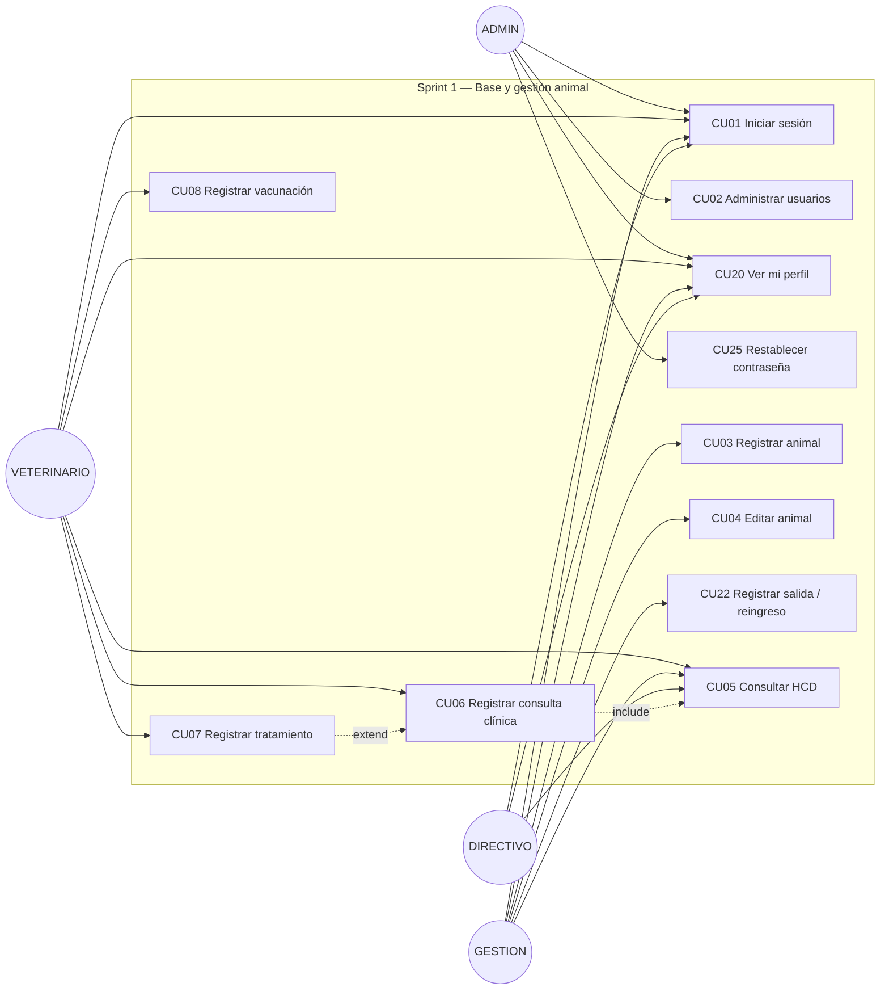

#### Clases — Sprint 1

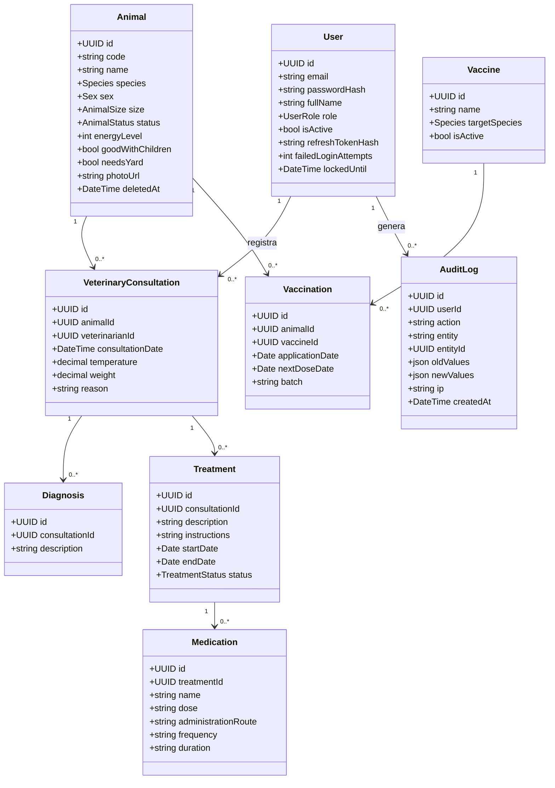

#### Paquetes — Sprint 1

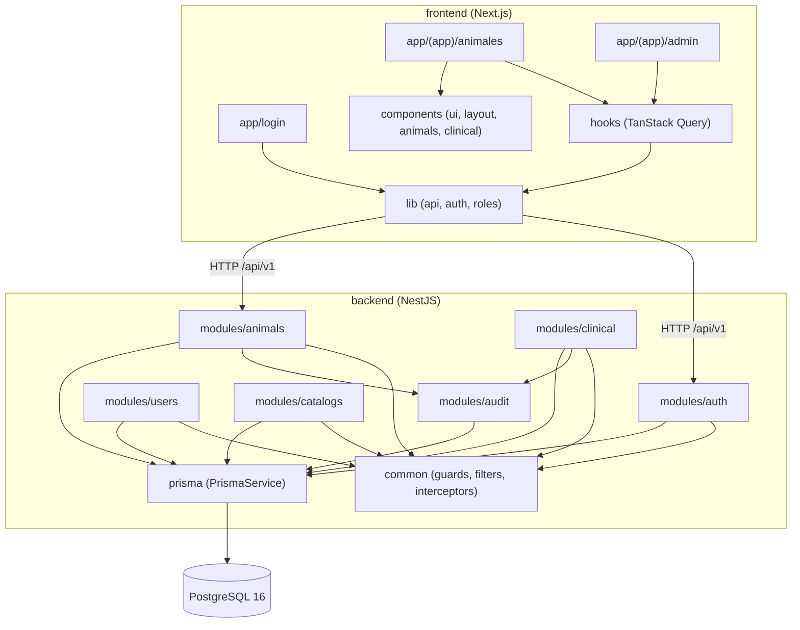

#### Despliegue — Sprint 1

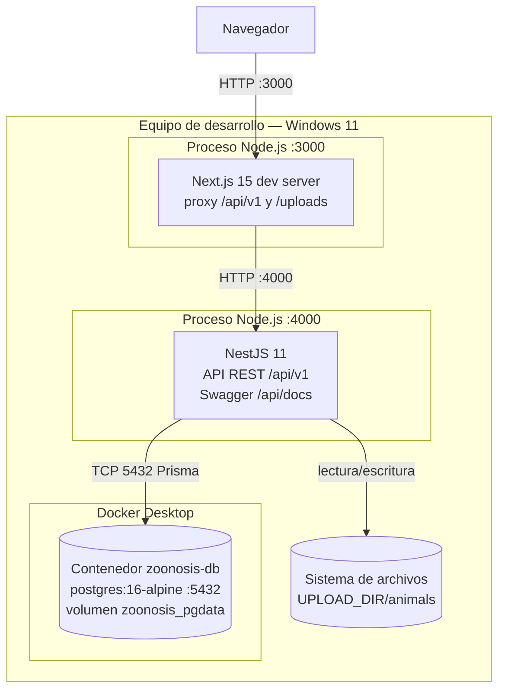

#### Secuencia — Sprint 1: registrar una consulta clínica

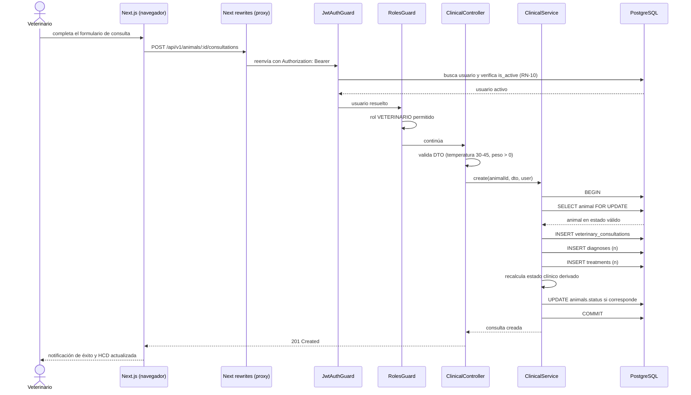

### Mockups / capturas de pantallas desarrolladas

**No existen** archivos de mockup ni capturas en el proyecto. Pantallas efectivamente desarrolladas
en este sprint (rutas reales de `frontend/src/app/`):

| Pantalla | Ruta |
|---|---|
| Inicio de sesión | `/login` |
| Mi perfil | `/(app)/perfil` |
| Administración de usuarios | `/(app)/admin/usuarios` |
| Catálogos (vacunas y pesos) | `/(app)/admin/catalogos` |
| Listado de animales | `/(app)/animales` |
| Alta de animal | `/(app)/animales/nuevo` |
| Ficha de animal con pestañas | `/(app)/animales/[id]` |
| Edición de animal | `/(app)/animales/[id]/editar` |
| Nueva consulta clínica | `/(app)/animales/[id]/consultas/nueva` |
| Detalle de consulta | `/(app)/animales/[id]/consultas/[consultaId]` |
| Control de vacunas | `/(app)/vacunas` |

### Plan de pruebas — Sprint 1

| HU | Caso de uso | Entrada | Condición | Procedimiento | Resultado esperado | Resultado obtenido |
|---|---|---|---|---|---|---|
| HU7 | CU01 Iniciar sesión | `admin@zoonosis.test` / `Zoo12345` | Usuario activo | `POST /auth/login` | 200 con token de acceso y cookie `httpOnly` de refresco | Correcto |
| HU7 | CU01 Credenciales inválidas | Email válido, contraseña incorrecta | — | `POST /auth/login` | 401 con mensaje genérico que no revela si la cuenta existe | Correcto |
| HU7 | CU02 Control de acceso | Token de rol sin permiso | — | `GET` a endpoint restringido | 401 sin token; 403 con rol sin permiso | Correcto |
| HU7 | CU02 + RN-10 | Usuario creado y luego desactivado | Token ya emitido | Crear usuario, desactivarlo, reusar su token | El token deja de funcionar inmediatamente | Correcto |
| HU7 | CU02 Autoprotección | Admin intenta desactivarse a sí mismo | — | `PATCH /users/:id` sobre sí mismo | 400 con mensaje de error | Correcto |
| HU1 | CU03 Registrar animal | Datos válidos de animal, rol `GESTION` | Sesión activa | `POST /animals` | 201, código con formato `ZOO-AAAA-NNNN` y estado `INGRESADO` | Correcto |
| HU2 | CU06 Validar signos vitales | Temperatura fuera de 30–45 °C o peso ≤ 0 | Animal en la institución | `POST /animals/:id/consultations` | 400 con el campo inválido señalado | Correcto |
| HU2 | CU05 Línea de tiempo | Animal con consultas, vacunas y períodos | Varios registros | `GET /animals/:id/timeline` | Eventos en orden cronológico inverso | Correcto |
| HU2 | CU07 Estado por tratamiento | Tratamiento en estado `ACTIVO` | Animal `INGRESADO` | Crear tratamiento y luego finalizarlo | Animal pasa a `EN_TRATAMIENTO` y vuelve a `INGRESADO` | Correcto |
| HU1 | CU22 Animal fuera | Animal en estado `ADOPTADO` | — | Intentar registrar una consulta; luego reingresar | La consulta se rechaza; el reingreso lo devuelve a `INGRESADO` | Correcto |
| HU7 | Guard de roles | Endpoint sin `@Roles()` | Rol `CLIENTE` | Prueba unitaria `roles.guard.spec.ts` | Acceso denegado por *deny by default* | Correcto |
| HU1 | Máquina de estados | Todas las transiciones del grafo | — | Prueba unitaria `animal-status.spec.ts` | Solo las transiciones válidas se permiten | Correcto |
| HU7 | Saneado de auditoría | Objeto con claves `password`, `token` | — | Prueba unitaria `sanitize.spec.ts` | Las claves sensibles se eliminan antes de guardar | Correcto |
| HU7 | Lógica de autenticación | Varios escenarios de login y bloqueo | — | Prueba unitaria `auth.service.spec.ts` | Bloqueo al 5.º fallo, rotación de refresco correcta | Correcto |

**Capturas de las pruebas: no existen.** La evidencia disponible es la salida de consola de
`npm test` y `npm run test:e2e`, no guardada como archivo en el proyecto.

### Incremento generado y despliegue

**Incremento:** sistema con autenticación funcional, control de acceso por rol, administración de
usuarios, registro completo de animales con fotografía y máquina de estados, e historia clínica
digital con consultas, diagnósticos, tratamientos, medicamentos y vacunaciones. Auditoría activa
sobre todas las operaciones.

**Despliegue: no existe.** El incremento se ejecuta en el entorno local de desarrollo:
`docker compose up -d` para la base de datos, `npm run db:setup` para migraciones y seed,
`npm run start:dev` en `backend/` y `npm run dev` en `frontend/`.

### Revisión del Sprint 1

| Ítem | Estado |
|---|---|
| Lugar | **Pendiente** |
| Fecha | **Pendiente** |
| Hora | **Pendiente** |
| Funcionalidad presentada | **Pendiente.** Verificable desde el código: inicio de sesión por los cuatro roles internos, administración de usuarios, alta y ficha de animal, registro de consulta clínica y de vacunación. |
| Retroalimentación recibida | **Pendiente** |
| Tareas completadas | 20 de 20 (SP1.1 a SP1.20), según el estado del código |

### Retrospectiva del Sprint 1

| Ítem | Estado |
|---|---|
| Lugar / fecha / hora | **Pendiente** |
| Qué salió bien | **Pendiente.** Dato verificable del código: la decisión de implementar el esquema completo en la migración inicial evitó fragmentar migraciones en los sprints siguientes (`DECISIONS.md`, punto 6). |
| Qué no salió bien | **Pendiente.** Dato verificable del código: Jest 30 no pudo usarse porque su resolver nativo requiere el runtime de Visual C++, ausente en el equipo; hubo que bajar a Jest 29 y reinstalar dependencias (`DECISIONS.md`, punto 3). |
| Qué mejorar | **Pendiente.** Observación derivada del estado del proyecto: inicializar el repositorio Git desde el Sprint 1 para tener trazabilidad de cambios y autoría. |

---

## Sprint 2 — Control sanitario y apertura del flujo de adopción

**Historias:** HU4, HU5, HU9, HU10 — **28 PHU**
**Fechas (propuestas):** 2026-10-20 a 2026-10-31

### Objetivo del sprint

Completar el control sanitario con los períodos de cuarentena y observación, y habilitar el flujo de
adopción de punta a punta: registro de adoptantes, creación de solicitudes con las reglas de negocio
RN-03 a RN-06 verificadas, motor de compatibilidad y decisión final de aprobación o rechazo.

### Tareas

| Id | Descripción | Horas est. | Responsable | Estado |
|---|---|---|---|---|
| SP2.1 | Módulo `clinical` (parte 3): períodos de observación y cuarentena, apertura y cierre | 8 | Julio | Terminada |
| SP2.2 | Controles dentro del período y cierre con confirmación obligatoria si no hay controles | 5 | Julio | Terminada |
| SP2.3 | Verificación de RN-03 y endpoints de habilitar / retirar de adopción | 6 | Julio | Terminada |
| SP2.4 | Índices únicos parciales `uq_one_active_period` y `uq_one_active_request` verificados | 3 | Julio | Terminada |
| SP2.5 | Módulo `adopters`: CRUD de adoptantes, CI única, perfil de adopción, enmascarado de CI para `DIRECTIVO` | 10 | Claudia | Terminada |
| SP2.6 | Módulo `adoptions`: creación de solicitud con bloqueo `FOR UPDATE` y RN-04/RN-05 | 10 | Claudia | Terminada |
| SP2.7 | Máquina de estados de la solicitud y endpoint `PATCH /status` | 6 | Claudia | Terminada |
| SP2.8 | Notas de evaluación acumulativas con fecha, autor y estado | 4 | Claudia | Terminada |
| SP2.9 | Endpoint `POST /decision` con validación de estado, nota y fecha de entrega | 6 | Claudia | Terminada |
| SP2.10 | Motor de compatibilidad `engine.ts` como función pura: 5 criterios, filtros duros, niveles | 14 | Julio | Terminada |
| SP2.11 | 22 pruebas unitarias del motor, incluido el ejemplo 90.625 → 90.63 ALTA | 8 | Julio | Terminada |
| SP2.12 | Servicio de recomendación: modo par y modo ranking, persistencia en `compatibility_recommendations` | 8 | Julio | Terminada |
| SP2.13 | Versionado de pesos del algoritmo con *advisory lock* y validación de suma 100 | 5 | Julio | Terminada |
| SP2.14 | Frontend: pantallas de adoptantes (listado, alta, ficha, edición) | 12 | Claudia | Terminada |
| SP2.15 | Frontend: pantallas de solicitudes (listado, alta, ficha con decisión y notas) | 14 | Claudia | Terminada |
| SP2.16 | Frontend: pantalla `/cuarentena` y pestaña de períodos en la ficha del animal | 8 | Julio | Terminada |
| SP2.17 | Frontend: catálogo `/adoptables` y componentes de ranking con barra de puntaje | 8 | Julio | Terminada |
| SP2.18 | Pruebas e2e de reglas de negocio: RN-03 a RN-07 y máquina de estados | 10 | Julio | Terminada |
| | **Total** | **145** | | |

### Diagramas del Sprint 2

#### Casos de uso — Sprint 2

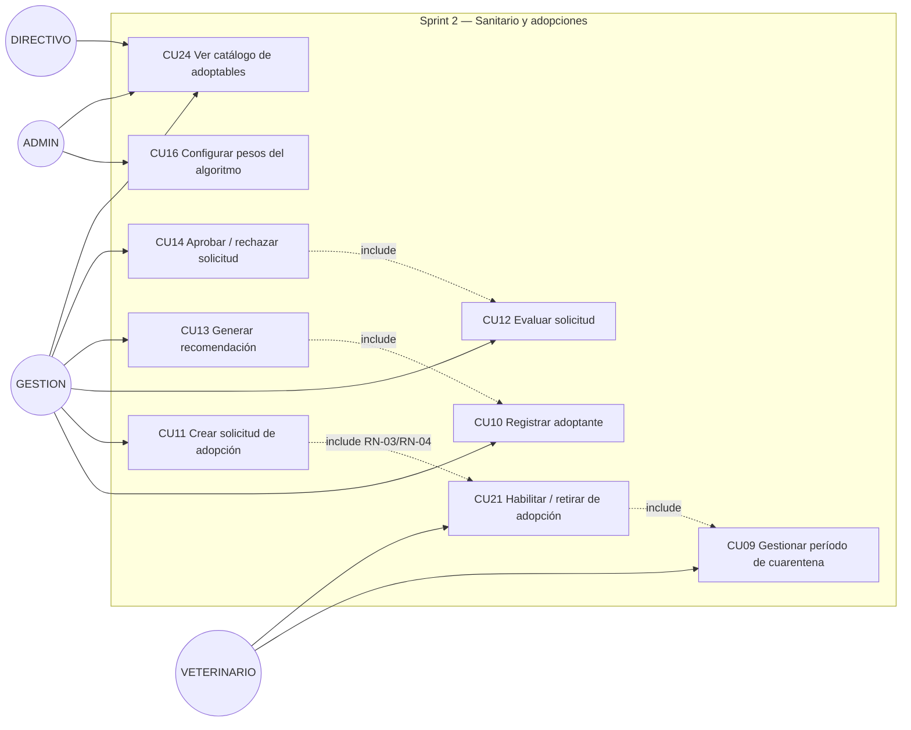

#### Clases — Sprint 2

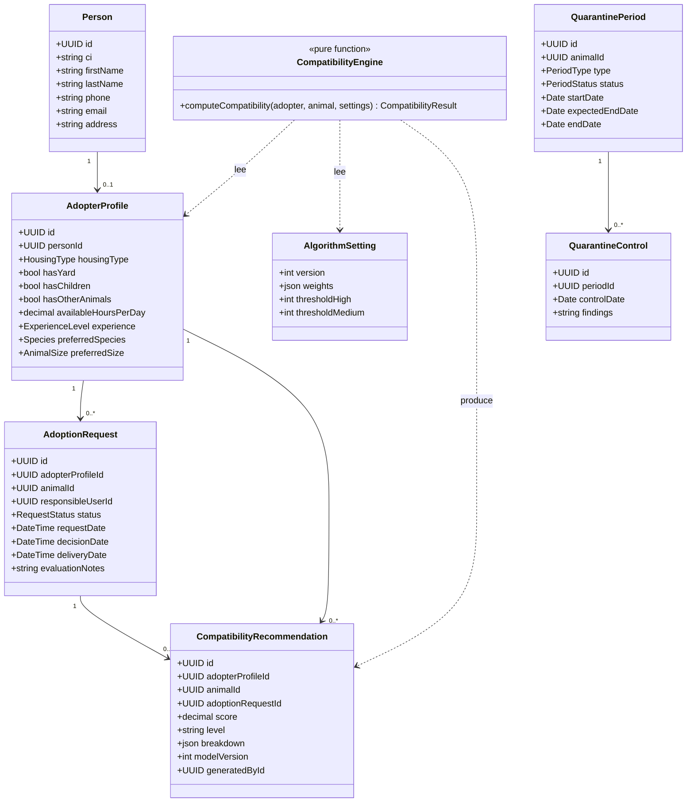

#### Paquetes — Sprint 2

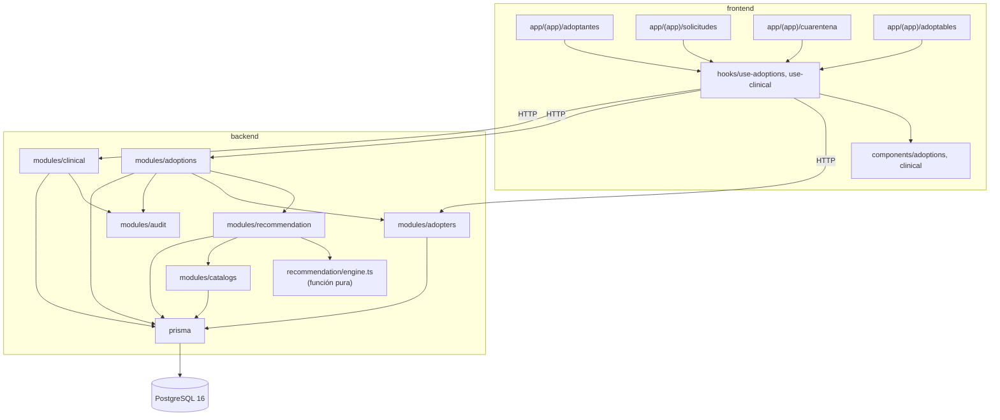

#### Despliegue — Sprint 2

Sin cambios respecto al Sprint 1: mismo entorno local, mismos tres procesos (Next en 3000, NestJS en
4000, PostgreSQL en contenedor Docker en 5432). No se incorporó ningún servicio externo en este sprint.

#### Secuencia — Sprint 2: crear una solicitud de adopción

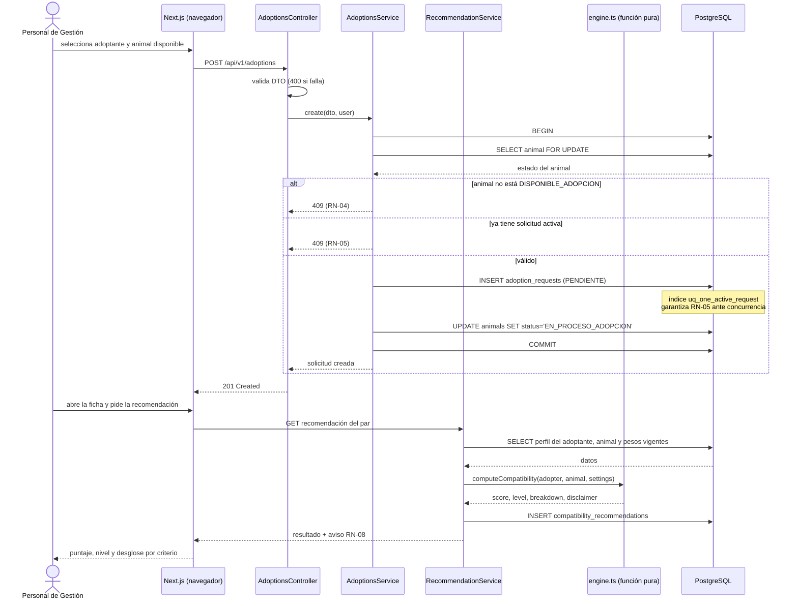

### Mockups / capturas de pantallas desarrolladas

**No existen** archivos de mockup ni capturas. Pantallas desarrolladas en este sprint:

| Pantalla | Ruta |
|---|---|
| Listado de adoptantes | `/(app)/adoptantes` |
| Alta de adoptante | `/(app)/adoptantes/nuevo` |
| Ficha de adoptante con ranking | `/(app)/adoptantes/[id]` |
| Edición de adoptante | `/(app)/adoptantes/[id]/editar` |
| Listado de solicitudes | `/(app)/solicitudes` |
| Alta de solicitud | `/(app)/solicitudes/nueva` |
| Ficha de solicitud con decisión y notas | `/(app)/solicitudes/[id]` |
| Control de cuarentena y observación | `/(app)/cuarentena` |
| Catálogo de adoptables | `/(app)/adoptables` |

### Plan de pruebas — Sprint 2

| HU | Caso de uso | Entrada | Condición | Procedimiento | Resultado esperado | Resultado obtenido |
|---|---|---|---|---|---|---|
| HU9 | RN-03 sin consulta | Animal sin ninguna consulta registrada | Sin período ni tratamiento activo | `POST /animals/:id/enable-adoption` | 409 con la lista de requisitos faltantes | Correcto |
| HU9 | CU09 Período único | Animal con un período `ACTIVO` | — | Intentar abrir un segundo período | 409: solo un período activo por animal | Correcto |
| HU9 | CU09 Cierre sin controles | Período activo sin ningún control | — | `POST /periods/:id/close` sin confirmación | 409 con `errors[0].field = confirmWithoutControls` | Correcto |
| HU9 | CU09 Bloqueo de RN-03 | Animal con cuarentena activa | Con consulta registrada | `POST /animals/:id/enable-adoption` | 409: la cuarentena activa impide habilitar | Correcto |
| HU9 | CU21 Habilitar | Animal con consulta, sin período ni tratamiento activo | Rol `VETERINARIO` | `POST /animals/:id/enable-adoption` | 200, animal pasa a `DISPONIBLE_ADOPCION` | Correcto |
| HU4 | CU10 CI única | Adoptante con CI ya registrada | — | `POST /adopters` | 409 con el id del adoptante existente | Correcto |
| HU4 | CU10 Horas válidas | `availableHoursPerDay` fuera de 0–24 | — | `POST /adopters` | 400 con el campo señalado | Correcto |
| HU4 | RN-04 | Animal en estado distinto de `DISPONIBLE_ADOPCION` | — | `POST /adoptions` | 409 | Correcto |
| HU4 | RN-05 | Animal con solicitud `PENDIENTE` | — | `POST /adoptions` por segunda vez | 409 por índice único parcial | Correcto |
| HU4 | RN-06 | Solicitud recién creada | — | Consultar el animal | Estado `EN_PROCESO_ADOPCION` | Correcto |
| HU10 | RN-06 Rechazo | Solicitud `EN_EVALUACION` | Con nota de decisión | `POST /adoptions/:id/decision` rechazando | Solicitud `RECHAZADA`, animal vuelve a `DISPONIBLE_ADOPCION` | Correcto |
| HU10 | CU14 Orden de validación | Aprobación sin fecha de entrega | Estado incorrecto además | `POST /adoptions/:id/decision` | 400 primero (cuerpo), antes que el 409 de estado | Correcto |
| HU12 | RN-07 | Solicitud no `APROBADA` | — | `POST /adoptions/:id/followups` | 409 | Correcto |
| HU5 | CU13 Ranking y par | Adoptante con perfil completo | Animales disponibles | Solicitar recomendación en ambos modos | Puntaje, desglose por criterio y aviso de RN-08 presentes | Correcto |
| HU5 | CU13 Ejemplo de la especificación | Caso del ejemplo 8.4 | — | Prueba unitaria `engine.spec.ts` | 90.625 se redondea a 90.63, nivel `ALTA` | Correcto |
| HU5 | CU16 Suma de pesos | Pesos que no suman 100 | Rol `ADMIN` | `POST /algorithm-settings` | 400: los pesos deben sumar 100 | Correcto |
| HU5 | CU13 Perfil incompleto | Adoptante con datos faltantes | — | Solicitar recomendación | 422 indicando los datos que faltan | Correcto |

**Capturas de las pruebas: no existen.**

### Incremento generado y despliegue

**Incremento:** control sanitario completo con períodos de cuarentena y observación, y flujo de
adopción operativo de punta a punta: registro de adoptantes con perfil, creación de solicitudes con
las reglas RN-03 a RN-06 verificadas tanto en el servicio como en base de datos, motor de
compatibilidad con pesos configurables y versionados, y decisión final de aprobación o rechazo con
actualización automática del estado del animal.

**Despliegue: no existe.** Mismo entorno local del Sprint 1.

### Revisión del Sprint 2

| Ítem | Estado |
|---|---|
| Lugar / fecha / hora | **Pendiente** |
| Funcionalidad presentada | **Pendiente.** Verificable desde el código: apertura y cierre de cuarentena, habilitación para adopción con RN-03, registro de adoptante, creación de solicitud, ranking de compatibilidad y decisión de aprobación. |
| Retroalimentación recibida | **Pendiente** |
| Tareas completadas | 18 de 18 (SP2.1 a SP2.18), según el estado del código |

### Retrospectiva del Sprint 2

| Ítem | Estado |
|---|---|
| Lugar / fecha / hora | **Pendiente** |
| Qué salió bien | **Pendiente.** Dato verificable del código: implementar el motor de compatibilidad como función pura, sin acceso a base de datos, permitió cubrirlo con 22 pruebas unitarias aisladas y reproducir exactamente el ejemplo de la especificación. |
| Qué no salió bien | **Pendiente.** Dato verificable del código: una prueba e2e de decisión esperaba 409 y recibía 400 porque la validación del cuerpo ocurre antes que la del estado; hubo que ajustar la prueba al orden real documentado (`DECISIONS.md`, punto 40). |
| Qué mejorar | **Pendiente.** Observación derivada del código: duplicar las reglas críticas en servicio y en base de datos (RN-05 con índice único parcial) resultó clave y conviene aplicarlo desde el diseño a cualquier regla de concurrencia futura. |

---

## Sprint 3 — Cierre del proceso, monitoreo y atención al ciudadano

**Historias:** HU6, HU8, HU11, HU12 — **19 PHU**
**Fechas (propuestas):** 2026-11-03 a 2026-11-14

### Objetivo del sprint

Cerrar el ciclo de adopción con el acta de entrega y el seguimiento posterior, entregar al personal
las herramientas de monitoreo (panel de indicadores, alertas, reportes y auditoría) y abrir el sistema
al ciudadano con el sitio público, el registro de clientes y el asistente virtual con IA.

### Tareas

| Id | Descripción | Horas est. | Responsable | Estado |
|---|---|---|---|---|
| SP3.1 | Endpoint del acta de entrega con datos del animal, adoptante y compromisos de tenencia | 5 | Claudia | Terminada |
| SP3.2 | Frontend: vista imprimible del acta con `window.print()` y estilos de impresión | 6 | Claudia | Terminada |
| SP3.3 | Seguimientos post-adopción: endpoints de alta y consulta con validación de RN-07 | 5 | Claudia | Terminada |
| SP3.4 | Frontend: sección de seguimientos en la ficha de solicitud y en la ficha del animal | 5 | Claudia | Terminada |
| SP3.5 | Módulo `dashboard`: cinco tarjetas de indicadores con aislamiento de fallos por sección | 8 | Julio | Terminada |
| SP3.6 | Distribución por estado y comparativa ingresos contra adopciones por mes | 5 | Julio | Terminada |
| SP3.7 | `AlertsService`: vacunas vencidas (RN-12), cuarentenas y tratamientos vencidos | 6 | Julio | Terminada |
| SP3.8 | Frontend: `/dashboard` y `/alertas` con gráficos Recharts y paleta categórica fija | 10 | Julio | Terminada |
| SP3.9 | Módulo `reports`: 8 reportes en 3 categorías con matriz de acceso por rol | 12 | Julio | Terminada |
| SP3.10 | Exportación CSV con separador `;`, BOM UTF-8 y coma decimal | 4 | Julio | Terminada |
| SP3.11 | Consulta de auditoría: filtros, facetas y endpoint de solo lectura | 6 | Julio | Terminada |
| SP3.12 | Frontend: `/reportes` y `/admin/auditoria` | 10 | Claudia | Terminada |
| SP3.13 | Rol `CLIENTE` en el enum y endurecimiento del `RolesGuard` a *deny by default* | 5 | Julio | Terminada |
| SP3.14 | Migración `portal_publico`: `users.phone`, `users.terms_accepted_at`, tabla `contact_messages` | 4 | Julio | Terminada |
| SP3.15 | Módulo `public`: info institucional, animales públicos con campos filtrados, registro de cliente | 8 | Claudia | Terminada |
| SP3.16 | Módulo `mail` con nodemailer y módulo `contact`: guardado del mensaje, aviso y acuse de recibo | 8 | Claudia | Terminada |
| SP3.17 | Módulo `chat`: integración con Claude, *prompt* cacheado, validación del historial, límite por IP | 10 | Julio | Terminada |
| SP3.18 | Frontend: landing pública con secciones, redes sociales, FAQ y formulario de contacto | 14 | Claudia | Terminada |
| SP3.19 | Frontend: `/registro`, `/terminos`, `/privacidad`, banner de cookies y portal del cliente | 12 | Claudia | Terminada |
| SP3.20 | Frontend: widget de chat flotante y pantalla `/portal/asistente` | 8 | Julio | Terminada |
| SP3.21 | Frontend: buzón `/mensajes` con contador de no leídos y cambio de estado | 6 | Claudia | Terminada |
| SP3.22 | Pruebas e2e del panel, reportes por rol, auditoría y sitio público | 10 | Julio | Terminada |
| SP3.23 | Documentación final: `README.md` y `DECISIONS.md` con 64 decisiones registradas | 6 | Julio | Terminada |
| | **Total** | **183** | | |

### Diagramas del Sprint 3

#### Casos de uso — Sprint 3

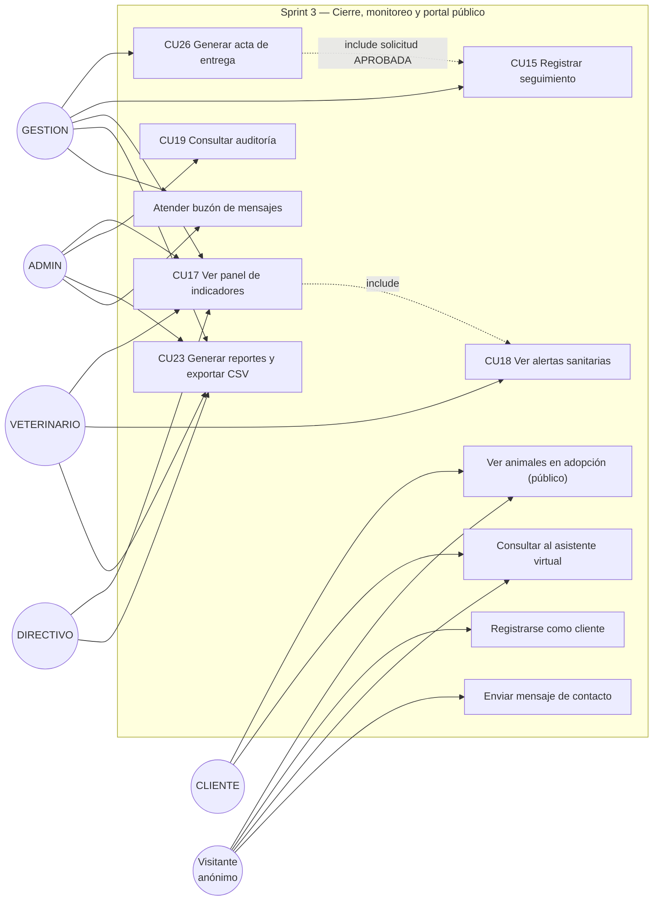

#### Clases — Sprint 3

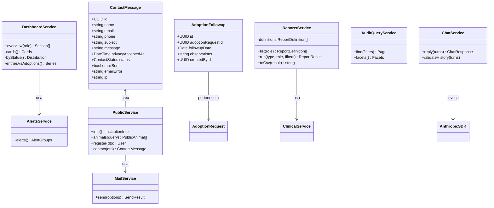

#### Paquetes — Sprint 3

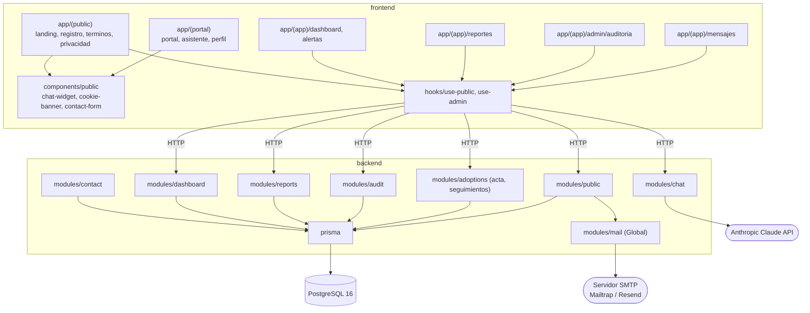

#### Despliegue — Sprint 3

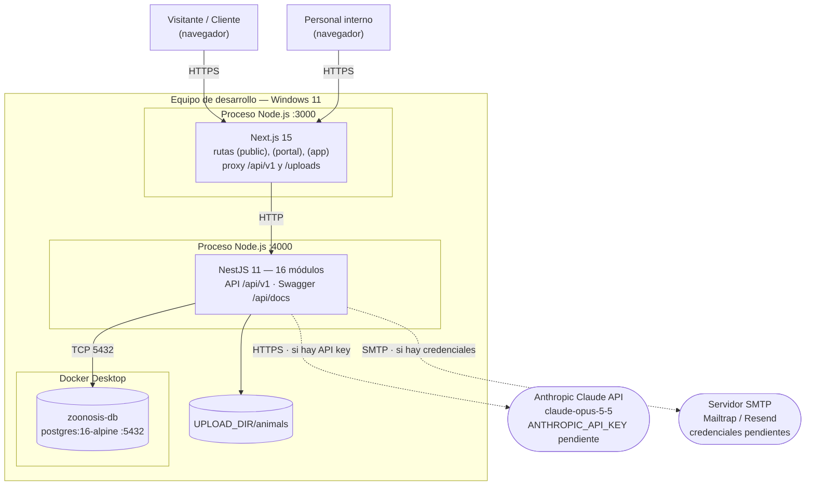

#### Secuencia — Sprint 3: consulta al asistente virtual

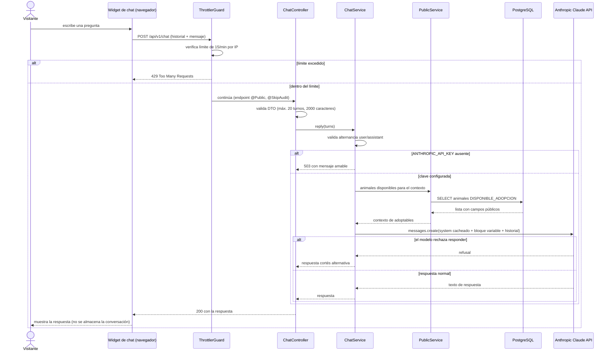

### Mockups / capturas de pantallas desarrolladas

**No existen** archivos de mockup ni capturas. Pantallas desarrolladas en este sprint:

| Pantalla | Ruta |
|---|---|
| Acta de entrega imprimible | `/(app)/solicitudes/[id]/acta` |
| Panel de indicadores | `/(app)/dashboard` |
| Centro de alertas sanitarias | `/(app)/alertas` |
| Reportes con exportación CSV | `/(app)/reportes` |
| Consulta de auditoría | `/(app)/admin/auditoria` |
| Buzón de mensajes web | `/(app)/mensajes` |
| Landing pública | `/(public)/` |
| Registro de cliente | `/(public)/registro` |
| Términos y Condiciones | `/(public)/terminos` |
| Política de Privacidad y Cookies | `/(public)/privacidad` |
| Portal del cliente | `/(portal)/portal` |
| Asistente virtual | `/(portal)/portal/asistente` |
| Perfil del cliente | `/(portal)/portal/perfil` |

### Plan de pruebas — Sprint 3

| HU | Caso de uso | Entrada | Condición | Procedimiento | Resultado esperado | Resultado obtenido |
|---|---|---|---|---|---|---|
| HU11 | CU26 Acta | Solicitud `APROBADA` | Con fecha de entrega | `GET /adoptions/:id/act` | Datos del animal, del adoptante y compromisos de tenencia | Correcto |
| HU12 | CU15 + RN-07 | Solicitud `APROBADA` | — | `POST /adoptions/:id/followups` | 201, seguimiento registrado con autor y fecha | Correcto |
| HU12 | RN-07 negativo | Solicitud `PENDIENTE` | — | `POST /adoptions/:id/followups` | 409 | Correcto |
| HU6 | CU17 Panel | Sesión de cualquier rol interno | Datos en la base | `GET /dashboard` | Cinco tarjetas, distribución por estado y comparativa mensual | Correcto |
| HU6 | CU18 Alertas | Vacuna con próxima dosis a ≤ 7 días | — | `GET /alerts` | La vacuna aparece como alerta (RN-12) | Correcto |
| HU6 | CU17 Aislamiento de fallos | Un indicador que falla | — | `GET /dashboard` | Ese indicador devuelve `{ok:false}` y el resto se muestra | Correcto |
| HU6 | CU23 Reportes por rol | Token de rol `VETERINARIO` | — | `GET /reports` y ejecutar uno de adopciones | Solo categorías `GENERAL` y `SANITARIO`; el de adopciones se rechaza | Correcto |
| HU6 | CU23 CSV | Reporte con decimales | — | Descargar CSV | Separador `;`, BOM UTF-8 y coma decimal | Correcto |
| HU7 | CU19 Auditoría | Acciones previas del sprint | Rol `ADMIN` | `GET /audit` y `GET /audit/facets` | Entradas con usuario, acción, entidad y valores antes/después | Correcto |
| HU8 | Asistente sin clave | Historial válido | `ANTHROPIC_API_KEY` vacía | `POST /chat` | 503 con mensaje amable | Correcto |
| HU8 | Validación del historial | Turnos no alternados o de tipo inválido | — | `POST /chat` | 400 rechazando el historial | Correcto |
| — | Animales públicos | Sin sesión | — | `GET /public/animals` | Solo animales `DISPONIBLE_ADOPCION` y solo campos públicos, sin HCD ni motivo de ingreso | Correcto |
| — | Registro de cliente | Formulario sin aceptar términos | — | `POST /public/register` | 400; con aceptación, se guarda `terms_accepted_at` | Correcto |
| — | Aislamiento del rol CLIENTE | Token de un cliente | — | `GET /auth/me` y luego un endpoint interno | 200 en el perfil; 403 en el endpoint interno | Correcto |
| — | Contacto | Formulario sin aceptar privacidad | — | `POST /public/contact` | 400; con aceptación, el mensaje se guarda aunque falle el envío | Correcto |

**Capturas de las pruebas: no existen.**

### Incremento generado y despliegue

**Incremento:** producto completo. Al cierre del sprint el sistema cubre el ciclo íntegro —ingreso del
animal, atención clínica, control sanitario, publicación para adopción, solicitud, evaluación con
apoyo del motor de compatibilidad, decisión, acta de entrega y seguimiento posterior— más las
herramientas de monitoreo del personal (panel, alertas, ocho reportes con exportación y auditoría
inmutable) y el canal de atención al ciudadano (landing pública, catálogo de adoptables, registro de
clientes con aceptación de términos, formulario de contacto con buzón interno y asistente virtual
con IA).

**Despliegue: no existe.** El despliegue quedó explícitamente fuera del alcance del proyecto. El
incremento se ejecuta en el entorno local descrito en la sección 2.3.

**Configuración pendiente para operar en producción:** `ANTHROPIC_API_KEY`, credenciales SMTP y los
valores reales de las variables `INSTITUTION_*` y `SOCIAL_*`, que hoy tienen datos de ejemplo.

### Revisión del Sprint 3

| Ítem | Estado |
|---|---|
| Lugar / fecha / hora | **Pendiente** |
| Funcionalidad presentada | **Pendiente.** Verificable desde el código: acta de entrega imprimible, seguimiento post-adopción, panel de indicadores con alertas, generación y exportación de reportes, consulta de auditoría, landing pública con registro de cliente, formulario de contacto con buzón interno y asistente virtual. |
| Retroalimentación recibida | **Pendiente** |
| Tareas completadas | 23 de 23 (SP3.1 a SP3.23), según el estado del código |

### Retrospectiva del Sprint 3

| Ítem | Estado |
|---|---|
| Lugar / fecha / hora | **Pendiente** |
| Qué salió bien | **Pendiente.** Dato verificable del código: el endurecimiento del `RolesGuard` a *deny by default* al incorporar el rol `CLIENTE` evitó exponer endpoints internos por omisión, y quedó cubierto por pruebas unitarias y e2e (`DECISIONS.md`, punto 56). |
| Qué no salió bien | **Pendiente.** Dato verificable del código: la ampliación del alcance con el sitio público llegó después de cerrar el plan original de siete fases, lo que obligó a revisar los permisos de todos los módulos ya terminados y a agregar una migración adicional (`portal_publico`). |
| Qué mejorar | **Pendiente.** Observaciones derivadas del estado del proyecto: (a) los textos legales de `/terminos` y `/privacidad` son un modelo y deben revisarse con un asesor legal antes de publicarse; (b) quedan pendientes las pruebas automatizadas de interfaz y la medición de rendimiento y usabilidad. |

---

# 5. Sprint 0 — Modelos iniciales

## 5.1 Modelo de contexto

**Descripción.** El sistema se sitúa entre tres grupos de actores y dos servicios externos. El
personal interno de la asociación —con cuatro perfiles diferenciados— opera el sistema de gestión: los
veterinarios registran la atención clínica y el control sanitario, el personal de gestión animal
administra el inventario de animales y el proceso de adopción, el personal directivo consulta
indicadores y reportes, y el administrador gestiona cuentas, catálogos y auditoría. El ciudadano
interactúa desde el sitio público: consulta los animales disponibles, se registra como cliente,
pregunta al asistente virtual y envía mensajes de contacto. Los dos servicios externos son la API de
Anthropic Claude, que da respuesta al asistente virtual, y un servidor SMTP, que entrega el aviso de
contacto a la institución y el acuse de recibo al visitante. La información persiste en una base
PostgreSQL y las fotografías de los animales en el sistema de archivos del servidor.

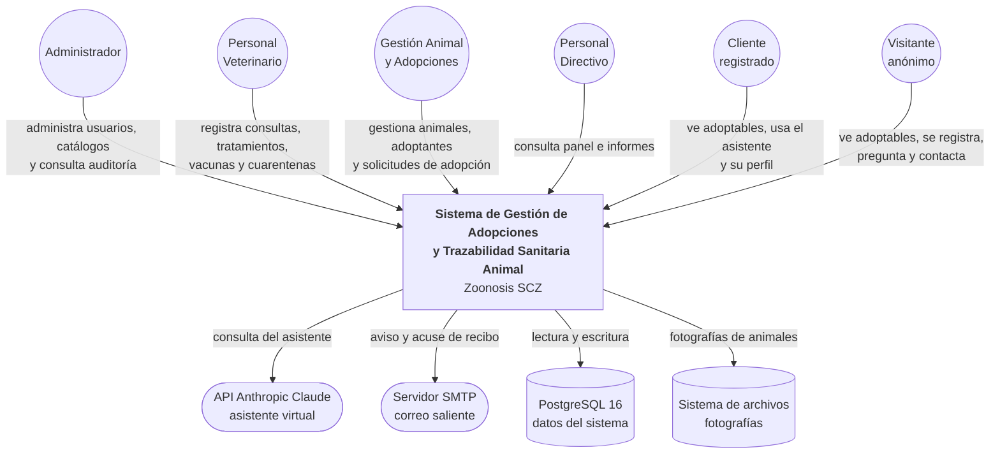

## 5.2 Modelo de datos (entidades principales)

**Descripción.** El modelo tiene **17 entidades** y **12 enumeraciones**, con nombres de tabla en
`snake_case` plural y claves primarias `uuid` generadas con `gen_random_uuid()`. Las entidades
principales se agrupan en cuatro bloques.

*Bloque de identidad y seguridad:* `users` concentra las cuentas con su rol, estado y hash del token
de refresco. La tabla de auditoría fue **eliminada** del proyecto (ver sección 6.2).

*Bloque animal:* `animals` es la entidad central, con código único, características, comportamiento y
estado; de ella cuelgan `veterinary_consultations` (y en cascada `diagnoses`, `treatments` y
`medications`), `vaccinations` (ligadas al catálogo `vaccines`) y `quarantine_periods` (con sus
`quarantine_controls`).

*Bloque adopción:* `persons` guarda los datos de identidad del adoptante y se relaciona uno a uno con
`adopter_profiles`, que contiene el perfil usado por el motor de compatibilidad;
`adoption_requests` vincula un perfil con un animal y lleva el estado del proceso;
`compatibility_recommendations` almacena el historial de puntajes calculados y
`adoption_followups` el acompañamiento posterior a la entrega.

*Bloque configuración y portal:* `algorithm_settings` versiona los pesos y umbrales del motor de
reglas, `ml_models` versiona los modelos de Random Forest entrenados (con su procedencia y sus
métricas) y `contact_messages` guarda los mensajes del formulario público.

Restricciones destacadas que el ORM no expresa y se agregaron con SQL en la migración inicial:
índices únicos parciales `uq_one_active_request` (una sola solicitud activa por animal, RN-05) y
`uq_one_active_period` (un solo período activo por animal), restricciones `CHECK` sobre rangos de
valores, índice sobre `lower(name)` y `uq_one_active_ml_model`, que garantiza un solo modelo activo.

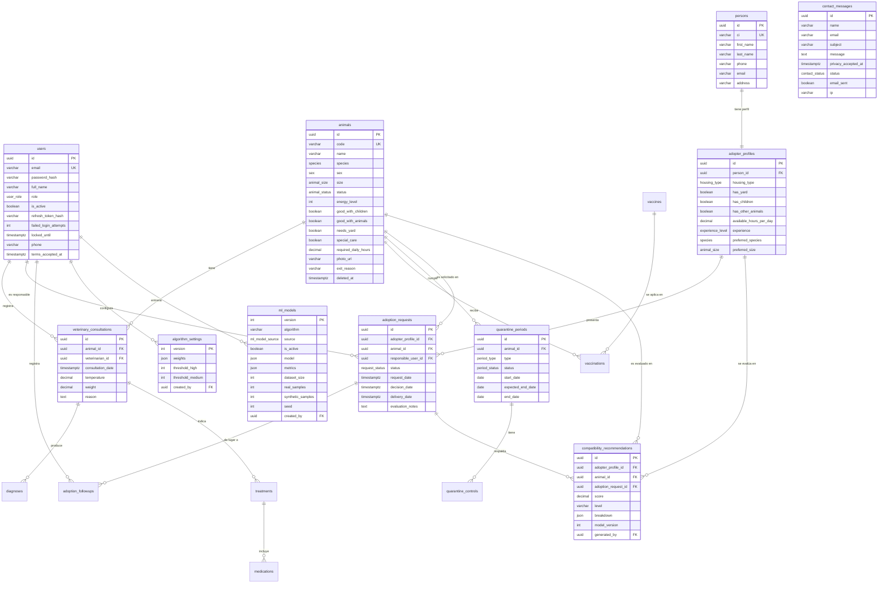

## 5.3 Modelo de arquitectura

**Descripción.** La arquitectura es **cliente-servidor en tres capas con API REST**, separada en dos
aplicaciones independientes dentro de un monorepo simple sin *workspaces*.

*Capa de presentación.* Aplicación Next.js 15 con App Router, organizada en tres grupos de rutas:
`(public)` para el sitio corporativo abierto, `(portal)` para el cliente registrado y `(app)` para el
personal interno con barra lateral filtrada por rol. Next cumple además el papel de **proxy inverso**:
reescribe `/api/v1` y `/uploads` hacia el backend, de modo que la cookie `httpOnly` del token de
refresco queda en el dominio del frontend, el `middleware.ts` puede comprobar si hay sesión y se
evitan los problemas de cookies de terceros. El estado del servidor se maneja con TanStack Query y los
formularios con React Hook Form más Zod.

*Capa de aplicación.* API NestJS 11 con **16 módulos** de responsabilidad única. Las preocupaciones
transversales se resuelven con elementos globales: `JwtAuthGuard` y `RolesGuard` registrados como
`APP_GUARD`, un interceptor de auditoría que usa `AsyncLocalStorage` para propagar usuario e IP, un
interceptor de serialización que convierte los `Decimal` de Prisma a número, y un filtro de
excepciones que uniforma toda respuesta de error al formato `{ statusCode, message, errors? }`.
La documentación de la API se genera automáticamente con Swagger en `/api/docs`. El motor de
compatibilidad está deliberadamente aislado como función pura, sin dependencias de infraestructura.

*Capa de datos.* PostgreSQL 16 accedido mediante Prisma 6 como ORM. Las reglas que el ORM no puede
expresar se implementan en SQL dentro de las migraciones: restricciones `CHECK`, índices únicos
parciales y el trigger de inmutabilidad de la auditoría. La concurrencia se controla con `SELECT ...
FOR UPDATE` en los cambios de estado y con `pg_advisory_xact_lock` en la generación de códigos y de
versiones del algoritmo.

*Integraciones externas.* Dos, ambas opcionales y degradadas con elegancia: la API de Anthropic Claude
para el asistente virtual (sin clave, responde 503 con un mensaje amable) y un servidor SMTP para el
correo del formulario de contacto (sin credenciales, el mensaje se guarda igual y queda visible en el
buzón interno).

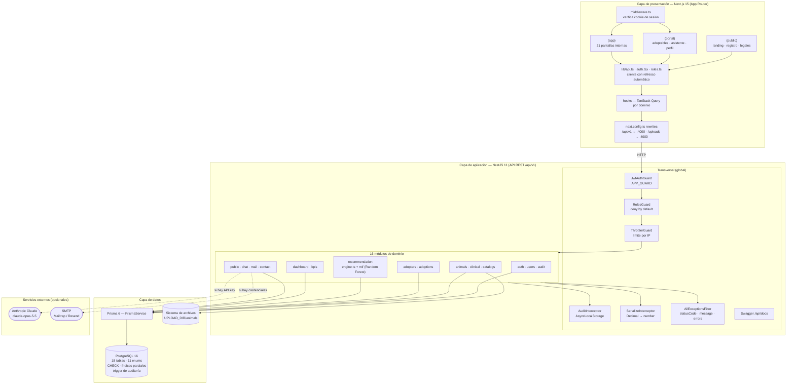

---

# 6. Decisiones del equipo

Esta sección reúne lo que el documento **no puede resolver desde el código** y requiere una decisión
explícita del equipo.

## 6.1 Qué historias van en cada sprint

**Propuesta ya aplicada en este documento** (sección 1.4), basada en prioridad y dependencias
técnicas reales:

| Sprint | Historias | PHU |
|---|---|---|
| Sprint 1 | HU1 Gestión de animal · HU2 Registro de consulta clínica · HU3 Gestión de vacunación · HU7 Gestión de usuario | 26 |
| Sprint 2 | HU4 Creación de solicitud de adopción · HU5 Recomendación de compatibilidad · HU9 Gestión de períodos de cuarentena · HU10 Aprobación o rechazo de solicitud | 28 |
| Sprint 3 | HU6 Panel de KPI en tiempo real · HU8 Asistente virtual con IA · HU11 Generación del acta de entrega · HU12 Seguimiento post-adopción | 19 |

**Acción del equipo:** confirmar o ajustar. Si se ajusta, conviene respetar estas dependencias
rígidas, que vienen del código y no son negociables:

- HU4 exige que HU2 y HU9 ya existan (RN-03 requiere al menos una consulta y ningún período activo).
- HU5 exige el perfil de adoptante que se crea en HU4.
- HU11 y HU12 exigen HU10 (solo existen sobre una solicitud `APROBADA`, RN-07).
- HU6 lee datos de todos los módulos anteriores.

## 6.2 Reemplazo de las historias antiguas (HU1–HU15)

**Decisión del equipo.** Este documento describe **12 historias nuevas** (HU1 a HU12) correspondientes
al sistema de gestión de adopciones y trazabilidad sanitaria animal. Las tablas y textos de las
historias antiguas (HU1 a HU15, de moda circular y blockchain) **no tienen ninguna relación** con el
proyecto actual y, si se mantienen, el documento quedaría describiendo dos productos distintos.

Recomendación: eliminarlas por completo y usar la numeración HU1–HU12 de este documento, que ya es
continua y no deja huecos.

## 6.3 Datos que el equipo debe completar

| Sección | Dato pendiente |
|---|---|
| 1.3 | Confirmar la duración del sprint (propuesto: 2 semanas, igual para los tres) |
| 1.5 | Fechas reales de inicio y fin de cada sprint (hay propuesta; el único dato verificable es la migración inicial del 2026-11-14) |
| 3 | Confirmar prioridad y puntos de historia (PHU) de las 12 historias |
| 4 | Horas estimadas y responsable real de cada tarea SP (hay propuesta de reparto) |
| 4 | Lugar, fecha y hora de las tres revisiones y las tres retrospectivas |
| 4 | Retroalimentación recibida en cada revisión |
| 4 | Contenido real de cada retrospectiva (hay un dato verificable del código por sprint como punto de partida) |
| 2.5 | Objetivos medibles de rendimiento, usabilidad y disponibilidad |

## 6.4 Cambios de alcance posteriores al plan original

Tres cambios modificaron el alcance después de cerrar las siete fases iniciales. Están todos
registrados en `DECISIONS.md` y hay que reflejarlos en el documento, porque **invalidan parte de
la especificación original**.

### a) Ampliación — sitio público y asistente con IA (decisiones 55–64)

Landing corporativa, rol `CLIENTE` con autoregistro, términos y condiciones con casilla de
aceptación, banner de cookies, formulario de contacto por correo y asistente virtual con Claude.
Obligó a endurecer el `RolesGuard` a *deny by default*.

### b) Ampliación — despliegue y aprendizaje automático (decisiones 65–84)

| Qué se agregó | Estado |
|---|---|
| Infraestructura completa para AWS EC2 (Docker, nginx, HTTPS con Let's Encrypt) | Escrita y validada, **no desplegada** |
| Almacenamiento de fotos en S3 con rol IAM | Configurado, probado con ambos drivers |
| CI/CD en GitHub Actions con publicación en GHCR | Escrito, **nunca ejecutado** |
| Random Forest propio en TypeScript, con versionado de modelos | Implementado, 46 pruebas, modelo v1 activo |
| Tabla `ml_models` y migración `20261114220254_modelos_ml` | Aplicada |

### c) Reducción — fuera auditoría, alertas, reportes y pesos editables (decisiones 85–92)

| Qué se retiró | Consecuencia que el documento debe registrar |
|---|---|
| **Auditoría completa** (tabla, trigger, interceptor, 41 llamadas) | **El sistema deja de cumplir RN-09.** La migración destruye el historial y no es reversible sin respaldo |
| **Alertas sanitarias** (campana, tarjeta del panel, página y endpoint) | **RN-12 pierde su superficie visible.** Las vacunas por vencer siguen consultables en `/vacunas` |
| **Ocho reportes con exportación CSV** | Reemplazados por **seis indicadores de gestión** en `/kpis` |
| **Edición de los pesos del algoritmo** | El modelo entrenado la reemplaza; los pesos siguen en la base como respaldo |
| Fecha y motivo de reingreso (CU22) | Vivían solo en la auditoría y no tenían columnas propias. Se retiraron del flujo en vez de descartarse en silencio |

Qué se agregó en el mismo movimiento:

- **Seis KPIs** comparados contra el periodo anterior de la misma duración: adopciones concretadas,
  permanencia hasta la adopción, animales devueltos, solicitudes recibidas, tiempo de evaluación y
  cobertura de vacunación. El color de la tendencia cruza dirección con signo, porque subir no
  siempre es una buena noticia.
- **Ranking inverso** de recomendación (`GET /recommendations/animal/:id`): desde la ficha del
  animal, qué adoptantes le convienen.
- El **catálogo de vacunas** se movió a `/vacunas` como segunda pestaña, para no dejar al
  administrador sin forma de dar de alta una vacuna.

### Efecto sobre las 12 historias de usuario

| Historia | Efecto |
|---|---|
| HU5 Recomendación | **Reescrita**: ahora Random Forest con el motor de reglas como respaldo, más el ranking inverso |
| HU6 Panel de KPI | El panel sigue; se le quitó la tarjeta de alertas y se sumó la página `/kpis` |
| HU7 Gestión de usuario | Sin cambios funcionales; perdió el registro en auditoría |
| HU1–HU4, HU8–HU12 | Sin cambios de alcance |

Las 12 historias **siguen siendo 12**. No se agregaron ni eliminaron historias; cambió el contenido
de HU5 y HU6.

---

## 6.5 Artefactos que no existen en el proyecto

Para que el documento no afirme nada que el proyecto no tenga:

| Artefacto | Estado | Observación |
|---|---|---|
| Repositorio Git | **Sí, local** | Rama `main`, 4 commits. **Falta crear el remoto en GitHub**: sin él no hay URL para los anexos |
| Herramienta de gestión (Jira, Trello, etc.) | No existe | — |
| Pipeline de CI/CD | **Escrito, nunca ejecutado** | Dos workflows listos; no han corrido porque el repositorio no tiene remoto |
| Dockerfile del backend y del frontend | **Sí** | Multi-etapa, verificados: las imágenes se construyen y arrancan |
| Despliegue en AWS | **Configurado, no desplegado** | Toda la infraestructura escrita y validada; falta cuenta de AWS |
| Dominio y URL pública | No existe | Bloquea el HTTPS: Let's Encrypt no emite certificados para direcciones IP |
| Mockups, wireframes y capturas de pantalla | No existe | Las rutas reales de las pantallas hacen de prototipo funcional |
| Capturas de la ejecución de pruebas | No existe | Solo salida de consola, no guardada |
| Colección Postman | No existe | Se usa Swagger UI en `/api/docs` |
| Pruebas automatizadas de interfaz (Playwright/Cypress) | No existe | Era opcional en la especificación |
| Pruebas de carga y métricas de rendimiento | No existe | — |
| Actas de revisión y retrospectiva | No existe | — |
| Respaldo automatizado de base de datos | No existe | El procedimiento manual está documentado en `README.md` y `DEPLOY.md` |
| Monitoreo y alertas de caída | No existe | Sin CloudWatch, Sentry ni servicio de disponibilidad |
| Registro de incidencias o bugs | No existe | No hay gestor de issues |
| Análisis de sistemas comparables (Cap I) | No existe | Requiere clonar repositorios y medirlos con `cloc` |
| Cálculo de complejidad ciclomática | No existe | Propuesta en `hola2.md`: `computeCompatibility` y `findBestSplit` |
| Claves de API y credenciales SMTP configuradas | Pendiente | `ANTHROPIC_API_KEY` vacía; SMTP sin credenciales; `INSTITUTION_*` y `SOCIAL_*` con valores de ejemplo |

---

*Documento generado a partir del código real del proyecto el 2026-11-14. Las fuentes verificables son
`backend/package.json`, `frontend/package.json`, `backend/prisma/schema.prisma`, los controladores de
los 16 módulos del backend, los 8 archivos de prueba, las 31 rutas de página del frontend,
`docker-compose.yml`, `docker-compose.prod.yml`, `.github/workflows/`, `README.md`, `DEPLOY.md` y
`DECISIONS.md` (92 decisiones registradas).*

*Las respuestas a las preguntas de `hola.md` —incluidas las métricas completas del modelo, el
detalle de la infraestructura y los datos para los capítulos PAPS y SQAP— están en [hola2.md](hola2.md).*
